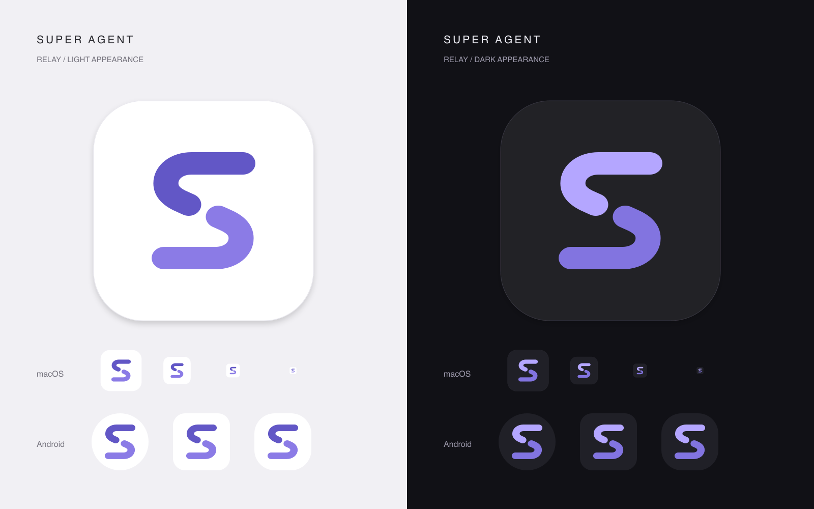

# Super Agent · Relay S

统一 macOS 与 Android 的应用标识。两条圆润、留有交接空隙的路径构成「S」，对应交办、推进和交付；沿用工作台的紫色，去掉文字和细碎装饰，保证小尺寸可辨认。



## 源文件与导出

- `mark.svg`：唯一的标记几何母版，可无损缩放。
- `macos/icon-{light,dark}.{svg,png}`：1024 × 1024，白色 / 炭灰色圆角底，外部透明，带轻微投影。
- `android/icon-{light,dark}.{svg,png}`：1024 × 1024，旧版桌面用圆角图标，外部透明。
- `android/foreground-{light,dark}.{svg,png}`：432 × 432，透明前景；置于 108 dp 画布时完整落在中央直径 66 dp 安全圆内。前景不包含圆角底或投影。
- `android/monochrome.{svg,png}`：与彩色前景相同几何，白色不透明笔画、透明背景，由支持主题图标的 Android 桌面着色。
- `android/icon-store.{svg,png}`：1024 × 1024，全白不透明底，用于 Expo 通用图标与商店素材；商店最终上传尺寸可另行导出。
- `preview.{svg,png}`：1600 × 1000，亮暗、16–96 px 与三种 Android 遮罩预览。

| 用途 | 亮色 | 暗色 |
| --- | --- | --- |
| 底色 | `#FFFFFF` | `#202027` |
| 上半标记 | `#6257C6` | `#B4A6FF` |
| 下半标记 | `#8B7BE6` | `#8274E0` |

图标为项目内直接绘制的 SVG，不依赖生成式图片或第三方商标。所有 PNG 都由同一母版确定性导出。重新生成需要本机 `rsvg-convert`（librsvg），不增加应用运行依赖：

```sh
python3 scripts/generate-app-icons.py
```

## 系统适配

macOS 的构建脚本打包标准多尺寸 `.icns` 以及两张外观 PNG；运行时监听应用的有效外观并替换 Dock 图标。当前 Swift Package / `.icns` 构建链的 Finder 与未启动图标使用亮色回退，不能宣称其支持完整的系统图标外观资产。详见 [macOS 集成说明](../../apps/macos/ICONS.md)。

Android 使用独立前景与背景、自适应图标和 `night` 资源；Android 13+ 另提供 `monochrome`。最终外形由系统桌面遮罩决定，部分桌面会缓存图标或只按自己的主题配置刷新。应用内界面配色不在本次图标变更范围内。详见 [Android 集成说明](../../apps/android/ICONS.md)。

平台依据：[Apple applicationIconImage](https://developer.apple.com/documentation/appkit/nsapplication/applicationiconimage)、[Apple effectiveAppearance](https://developer.apple.com/documentation/appkit/nsapplication/effectiveappearance)、[Android Adaptive icons](https://developer.android.com/develop/ui/compose/system/icon_design_adaptive)。

## 本轮验证（2026-11-19）

- 所有 SVG / PNG 可重复生成，逐文件 SHA-256 一致；尺寸、透明边界和白底取样正确，Android 前景 alpha 像素均处于安全圆内。
- macOS Swift 编译、独立 staging 应用构建、plist、签名验证和完整 `.icns` 解包通过。隔离 AppKit 进程仅覆盖自身外观，确认 Dock 图像亮→暗→亮切换且两次亮色一致；未修改系统设置或启动用户的真实登录会话。可运行包在 `apps/macos/build/icon-staging/Super Agent.app`，本机验证记录在 `apps/macos/build/icon-smoke/`（均为忽略的构建产物）。
- Android 29 个资源经 AAPT2 编译、链接；隔离副本执行完整 Expo prebuild 后仍保留 Manifest、新图标和暗色资源。本轮未生成 APK、未做 Android 真机桌面验证。
