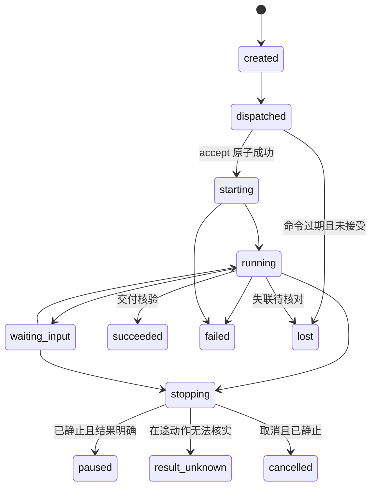

# 接口与事件协议 v1 草案

状态：设计契约，2026-11-18。配套：[技术设计](technical-design.md)、[JSON Schema](contracts/README.md)。URL 均相对于本产品控制服务；示例标识为虚构值，不代表已部署接口。

## 1. 通用约定

- HTTPS REST `/v1`；WSS 子协议 `super-agent.v1`；时间用 UTC RFC3339。
- UUID 标识，不把租户信息编码成可自行授权的对象 ID。
- 金额和 bigint 序号以十进制字符串传输；Token 计数为非负整数或 null，null 表示不可取得。
- 请求 schema 严格校验，响应白名单序列化；v1 增加可选字段允许兼容，删除/改变含义或必填字段增加需要新版本。
- REST 对象有 `version`；修改带 `If-Match: "<version>"`。缺失返回 428，冲突返回 412。命令/问题答案也校验对象版本。
- 创建/动作带 `Idempotency-Key`，按 principal、tenant、route、key 作用域存请求 hash 和原响应；同键同请求返回原结果，同键不同内容 409。幂等记录建议 7 天，设备命令记录至少覆盖命令生命周期与补传期限。
- 不存在或无权访问的业务资源统一 404，避免对象枚举。合法对象但状态不允许返回 409；401 身份无效，403 已知自身操作缺少 scope，422 参数/能力冲突，429 限流，503 依赖服务不可用。
- 标准错误体：`{ "error": { "code": "device_unavailable", "message": "指定电脑当前离线", "retryable": true, "request_id": "…" } }`。具体 error schema 实施 P1 固定。
- 所有 tenant 均来自身份；客户端或节点提交的 tenant 字段只可作为服务器签发上下文的引用，不能决定访问权。

## 2. 身份与调用角色

| 身份 | 来源 | 权限 |
| --- | --- | --- |
| client | OIDC 后建立的产品会话 | 本用户交办、设备设置、查看、接管、记忆与成本 |
| device | 设备私钥挑战换取的短期 token | 自己的连接、能力、命令、已有 Run 认证与报告 |
| coordinator | 本用户设备身份 + 有效 assistant lease | 读取分派给自己的消息、创建/协调授权任务、统一回复 |
| run | 设备身份 + run ticket | 本 Run 工具访问、受限记忆/文件、提问与回报 |
| ops_cost | 独立受权运维会话 | 指定聚合，不包含普通内容访问权 |

`run ticket` 不等于模型 Key；前者仅用于访问本产品，后者只由 Mac 直连供应商使用。任一 token 均不出现在 URL、普通日志或截图证据中。

## 3. REST 接口目录

表中 c/d/a/r/o 对应 client/device/coordinator/run/ops_cost。资源列表默认游标分页；客户端不能传入其他用户的 scope。

### 3.1 身份与设备

| 方法 / 路径 | 角色 | 语义 |
| --- | --- | --- |
| POST `/auth/exchange` | 上游 API access token | 校验 OIDC 身份并建立客户端会话 |
| POST `/auth/refresh` | refresh session | 旋转刷新凭证，返回新短期 access token |
| POST `/auth/logout` | c | 撤销当前会话与订阅 |
| GET `/me` | c | 本人、tenant、角色、偏好、服务能力 |
| GET/DELETE `/sessions/{id}` | c | 查看/撤销自己的会话 |
| POST `/device-pairings` | 尚未配对节点，限流 | 公钥、展示名称与挑战关联，返回短码和节点轮询凭证 |
| POST `/device-pairings/claim` | c | 用户检查指纹后认领待配对节点 |
| POST `/device-pairings/poll` | 配对轮询凭证 | 返回是否认领与 device ID；无模型凭据 |
| POST `/devices/auth/challenge` | device ID，限流 | 单次 nonce、签名上下文与到期时间 |
| POST `/devices/auth/token` | 设备签名 | 验证私钥、消费 nonce，换短期设备 token |
| GET `/devices` | c | 本用户设备、状态、能力摘要与负载 |
| PATCH/DELETE `/devices/{id}` | c | 更新名称/标签/可调度状态，或撤销设备 |
| PUT `/devices/{id}/capabilities` | d，仅自身 | 上报新 generation，不包含 Key/账号原始响应 |
| PUT `/settings/execution` | c | 默认引擎、设备、主助理电脑及候选策略 |
| POST `/assistant/lease/claim` | d | 按用户设置与期望 epoch 获取主助理租约 |
| POST `/assistant/lease/renew` | a | 续租并取得消息补读位置 |

### 3.2 对话与任务

| 方法 / 路径 | 角色 | 语义 |
| --- | --- | --- |
| POST `/messages` | c | 持久化消息，关联可选任务和执行偏好 |
| GET `/threads/{id}/messages` | c/a，范围限定 | 对话历史分页 |
| POST `/assistant/messages` | a | 有效 lease 下提交统一回复，关联源消息/任务 |
| POST `/assistant/plans` | a | 为待处理来源事件取得稳定 plan ID，重复请求返回已有草案/提交结果 |
| GET `/assistant/plans/{id}` | a | 恢复规划及已有 Task，避免重启后重复派活 |
| POST `/assistant/plans/{id}/commit` | a | 原子提交稳定 item key 对应的 Task、scope 来源与来源事件消费标记 |
| POST `/tasks` | c/a | 创建结构化任务，关联授权原始消息或有效规则 |
| GET `/tasks`、GET `/tasks/{id}` | c/a | 列表和详情，包含当前 Run 与等待原因 |
| PATCH `/tasks/{id}` | c/a | 修改未执行目标/配置；扩权需要有效用户依据 |
| POST `/tasks/{id}/actions` | c/a，动作权限限定 | pause/resume/cancel/switch/retry，返回 action ID 与接收状态 |
| POST `/tasks/{id}/inputs` | c/a | 运行中补充；a 不能替代用户作需确认的决定 |
| POST `/tasks/{id}/confirmations` | c | 对 scope version 的具体确认/拒绝 |
| GET `/tasks/{id}/runs` | c/a | 所有尝试、子任务与切换历史 |
| GET `/runs/{id}/steps` | c/a/r，范围限定 | 业务步骤、受管工具和回执 |
| POST `/questions/{id}/answers` | c | 回答特定 question version，原子记录唯一有效答案 |
| POST `/node/tasks` | a | 主助理创建子任务/独立任务的设备侧入口，scope 不可扩大 |
| GET `/node/commands` | d | 当前设备未确认的有效命令补读 |
| POST `/node/runs/{id}/accept` | d | 原子校验命令期限、epoch、设备、能力与状态，取得短期 run ticket |
| POST `/node/runs/{id}/renew` | d+r | 续租、额度状态和待处理控制请求 |
| POST `/node/reports` | d，加 Run/历史回报校验 | 批量发送状态、步骤、回执和用量，兼容 WS 不可用时 |
| POST `/node/reconcile` | d | 重连报告本机实际 Run、原生绑定及 producer 状态 |
| POST `/node/runs/{id}/questions` | r | 持久化问题，返回 question ID |
| POST `/node/runs/{id}/checkpoint` | r | 按 schema 上传检查点与哈希；历史记录也核对归属 |
| POST `/node/runs/{id}/budget-reservations` | r | 为当前 Run 申请/续期额度；不是供应商余额接口 |

### 3.3 记忆、文件与媒体

| 方法 / 路径 | 角色 | 语义 |
| --- | --- | --- |
| GET/POST `/memories` | c | 列出/教学写入知识，来源为明确用户输入 |
| GET/PATCH/DELETE `/memories/{id}` | c | 查看、纠错、失效或删除 |
| POST `/node/memory/search` | r/a | 任务范围内检索，返回摘要、来源、版本和索引 generation |
| POST `/node/memory/read` | r/a | 分段读取引用，校验记忆与当前 scope |
| POST `/node/memory/proposals` | r/a | 提交候选事实/流程，无法创建授权记录 |
| POST `/artifacts/uploads` | c/r | 获取短期上传授权、object key、最大大小和允许 mime |
| POST `/artifacts/{id}/finalize` | c/r | 校验大小/hash、归属与对象存在，再使引用可见 |
| GET `/artifacts/{id}/download` | c/r，范围限定 | 鉴权后短期下载，设置安全内容类型与 disposition |
| POST `/runs/{id}/views` | c | 创建只读画面会话，绑定本机 tab 与允许分辨率 |
| POST `/views/{id}/control` | c | 请求暂停并取得独占人类控制资格 |
| POST `/views/{id}/inputs` | c + control lease | 输入引用 frame 与 viewport version，服务端再校验并转发 |
| DELETE `/views/{id}/control` | c | 结束接管，任务保持 paused，用户另发 resume |
| DELETE `/views/{id}` | c | 结束订阅，无其他 viewer 时停止连续采集 |

### 3.4 自动化、成本与同步

| 方法 / 路径 | 角色 | 语义 |
| --- | --- | --- |
| GET/POST/PATCH `/schedules[/{id}]` | c | 周期规则、观察范围、授权版本与开关 |
| GET `/notifications` | c | 持久待处理通知，推送丢失可补读 |
| POST `/clients/push-registrations` | c | 注册本会话客户端推送地址，验证用户归属 |
| GET `/costs/summary` | c | 时间范围费用、来源分类、Token、覆盖率、更新时间 |
| GET `/costs/series` | c | 日趋势，timezone/currency 明确 |
| GET `/costs/breakdown` | c | 按 engine/model/device/project/task/category 分组 |
| GET `/costs/records` | c | 逐条消费与修订下钻，分页 |
| GET/PUT `/budgets` | c | 个人、主动任务、单任务预算设置 |
| POST `/costs/exports` | c | 异步导出本人数据，文件仍鉴权且有保留期限 |
| GET `/ops/costs/summary` | o | 受权跨用户聚合，独立审计与字段白名单 |
| POST `/sync/bootstrap` | c | 返回一致快照中的活跃任务/设备/待处理摘要与 stream cursor |
| GET `/events?after=...` | c | 本租户持久流补读，已失效游标返回 410 cursor_expired |
| POST `/ws-tickets` | c/d | 签发短期一次性、按用途绑定的 WS 票据 |

复杂列表/导出限定查询时间、最大条数和速率。成本 source 分类保留，不把不同费用来源简单混成“已结算总额”。

## 4. 请求样例与执行配置

创建消息时只提交偏好，真正 Run 配置由服务端与设备能力核实后固定：

```json
{
  "client_message_id": "00000000-0000-4000-8000-000000000001",
  "text": "检查昨天的发布是否有异常",
  "execution_preference": {
    "engine": "grok",
    "device_id": "00000000-0000-4000-8000-000000000002",
    "selection_mode": "pinned"
  }
}
```

设备能力快照包含 `generation`、`engines[].engine/models/ready/reason`、`tools`、`slots` 和可由用户编辑的标签。`ready` 只是采集时状态，接受 Run 时还要重新检查。

Run 固定 `engine/model_id/device_id/local_profile_id/scope_version_id/capability_generation/parent_run_id/root_run_id`。local_profile_id 是本机非敏感配置别名，不是账号密码；服务器不得提供下载模型 Key 的接口。

默认选择优先级：单任务覆盖 → 用户默认 → 允许的自动策略。缺少引擎能力或指定设备离线时不静默切换。模型 ID 只允许从目标设备报告的可用集合选择；服务器只负责一致性与能力条件。

运行中切换请求：

```json
{
  "action": "switch",
  "target": {
    "engine": "codex",
    "device_id": "00000000-0000-4000-8000-000000000003"
  },
  "reason": "改用家里的电脑继续处理"
}
```

响应 202 表示动作已持久化，不表示旧模型或工具已经停止；前端追踪 action ID 对应事件和任务状态。

## 5. WebSocket 与持久事件

### 5.1 三类独立连接

| 连接 | 用途 | 行为 |
| --- | --- | --- |
| `/v1/ws/client` | 客户端事件流 | 已授权本租户事件，支持 after cursor 和 ACK |
| `/v1/ws/device` | 节点命令、回报与心跳 | 设备级认证，Run 级动作继续核对授权 |
| `/v1/ws/media` | 图像帧与采集控制 | view ticket，最新帧优先，不持久补传 |

通过 HTTPS 取得一次性 ticket，建议 30 秒 TTL，绑定 principal/session/device/view 和用途。升级后 5 秒内在首个 auth frame 中发送票据；认证前不订阅、不发业务数据。禁止 query string token。每条连接有大小/速率/队列上限，认证失败立即关闭。

设备心跳建议 10 秒一次，服务器返回时间、connection generation 与续租提示。心跳不能代替 Run/资源续租。多连接竞争时只让最新 generation 接收新命令，旧历史回报可经明确的补传入口处理。

### 5.2 设备线上消息信封

受首批 JSON Schema 约束的四种消息见 [contracts](contracts/README.md)：

```json
{
  "protocol_version": "1.0",
  "message_id": "00000000-0000-4000-8000-000000000004",
  "kind": "run.state",
  "sent_at": "2026-11-18T12:00:00Z",
  "payload": {
    "device_id": "00000000-0000-4000-8000-000000000002",
    "run_id": "00000000-0000-4000-8000-000000000005",
    "lease_epoch": "1",
    "producer_id": "00000000-0000-4000-8000-000000000006",
    "producer_seq": "1",
    "state": "running",
    "summary": "正在读取发布记录"
  }
}
```

message_id 重传不变。device report 不接收客户端自定 tenant_id，归属从设备认证和 Run 记录推导。producer ID 在同一个 Run 生产者的本地持久化周期内不变，sequence 由 SQLite 事务单调递增；丢失本地数据库时先 reconcile，再申请新的 producer，不重用旧序列。

主助理将已提交规划恢复为原 plan，而不是重做无关联的任务创建。相同源输入的同一计划提交原子去重；扩权或用户改变目标才建立新版本。普通 `POST /tasks` 仍用于明确的单任务创建，必须携带稳定的幂等请求 ID 和来源；批量拆解使用 plan commit。

`command.ack` 仅表示节点已存储/拒绝/识别重复命令。节点必须调用 `/node/runs/{id}/accept` 并取得当前短期授权后才能开始 Runtime，不能凭离线保存的 run.start 命令无限期执行。

服务端持久提交回报后发送 transport ACK，ACK 中含 message_id、accepted receipt、可用 stream_seq。重复相同消息返回原收据；同 ID 不同 hash 返回冲突。消息格式校验不替代运行归属、租约、scope、状态迁移与预算检查。

### 5.3 客户端持久事件

事件字段：event_id、tenant stream_seq、type、occurred_at、recorded_at、task_id/run_id（可选）、entity_version、payload。服务器分配租户提交有序的 stream_seq，不能使用节点本地时间排序作为状态依据。

核心目录：

| 事件 | 内容 |
| --- | --- |
| message.created / assistant.replied | 对话内容或引用、所属 thread、回复关联 |
| device.changed / assistant.lease.changed | 在线/能力变化与主助理变化 |
| task.created / task.changed | Task 状态、原因、版本和当前 Run |
| run.started / run.changed / run.finished | 实际 Run、engine/model/device、状态与原因 |
| step.updated / tool.receipt | 业务步骤和关键工具证据 |
| question.created / question.resolved | 问题版本、答案或清理原因 |
| checkpoint.created / artifact.ready | 已校验引用 |
| memory.changed | 记忆版本与失效提示，不广播所有内容 |
| usage.changed / budget.changed | 用量修订、额度状态、聚合水位 |
| notification.created | 持久待处理项 |

bootstrap 从一致数据库快照取得活跃对象摘要与 cursor；随后补读 `stream_seq > cursor` 再实时订阅。快照过大时使用短期物化分页快照，不能用不同时间的多页结果冒充同一水位。历史列表单独分页，实体版本阻止旧结果覆盖新事件。

游标过期返回 410，客户端重新 bootstrap；不能跳到当前头部而静默漏掉待处理问题。通知/问题有独立持久记录，事件留存结束不等于问题消失。

### 5.4 画面帧

媒体 frame metadata 包含 view_id、run/device/tab、frame_id、viewport_version、captured_at、pixel_size、CSS viewport、scale/offset；随后传二进制 JPEG。control input 引用 frame/viewport version 和 human lease，节点检查当前实际 viewport，过时输入拒绝。

首版每连接只订阅一个 view，多个 viewer 复用本机采集。每 viewer 最多保留一张待发新帧，旧帧丢弃；重连请求新帧，不补发过期画面。元数据、图像大小上限和二进制 framing 在媒体原型阶段固定，不混入持久 JSON 事件协议。

## 6. 状态机与交接

### 6.1 Task 是用户工作，Run 是一次执行

Task 状态：`queued/running/waiting_input/waiting_device/awaiting_approval/pausing/paused/switching/awaiting_review/succeeded/failed/cancelled`，等待的具体原因用 `reason_code`，未执行的输入草稿留在对话或任务草稿，不伪造 Run。

Run 状态：`created/dispatched/starting/running/waiting_input/stopping/paused/succeeded/failed/cancelled/lost/result_unknown`。created/dispatched/lost 由服务端调度或恢复逻辑控制；节点只报告获准的事实状态，不能自行给别人的 Run 派发权限。



这是主要迁移图；状态迁移表在实现中显式维护，不能以任意 PATCH 修改状态。paused 后继续可以同设备恢复原生 thread，但建立新的 Run；succeeded/failed/cancelled 终态不可逆。lost/result_unknown 是待核对状态，可通过 reconcile 取得事实终态，不能按普通失败立即重跑副作用。

Task 只有在该版本目标的交付核验通过后进入 succeeded；需要人验收的进入 awaiting_review。任务失败可由新 Run 重试，旧 Run 终态不回退。

### 6.2 命令派发与过期

run.start 建议 60 秒有效期、5 秒 ACK 超时，有限退避重投同命令。accept 在服务器事务内验证命令未过期、目标 Run、设备和 epoch，并从 dispatched 迁移 starting；本地持久接受记录后再启动模型。

命令过期且从未 accept 可安全重新排队/新建 Run；一旦 accept 成功，失联就可能已经执行，必须 reconcile。服务端 action 接收、command stored、Run starting/running 是不同阶段，UI 分别展示。

暂停/切换不把“中断请求返回成功”当作业务静止证据。先拒绝新工具，处理在途回执，停止受管子树，再发布 checkpoint 和新执行授权。epoch 失效的晚到消息只能作为历史事实补充；有影响的晚到提交触发当前 Task 重新核对。

### 6.3 检查点契约

至少包含 checkpoint_schema_version、task/scope version、source run/engine/device、用户原始目标与补充引用、已完成步骤和确定回执、进行中工具与结果确定性、文件引用及可迁移性、记忆 ID/version、未解决问题、下一步、environment requirements、创建时间与 hash。

检查点不含模型认证、Cookie、Keychain 或隐藏推理。服务器校验所有引用属于同租户且未越出 scope；目标电脑读取 artifact 需重新鉴权。缺少必要本地文件/登录态时停止在 waiting_input/device reason，不假装原环境已复制。

## 7. 用量与费用语义

消费身份：`tenant + device + run + request_key`。request_key 标识实际一次供应商请求/原生回合采样单元；供应商重试产生独立请求时用新 identity，单次流式更新保持同一 identity。

usage_revision 单调递增：provisional → final 或 missing。同 revision 同 payload 去重，同 revision 不同 payload 冲突。累计快照先由适配器转成唯一消费记录或单独非可加快照，不能把累计总额和请求明细一起求和。

费用 `source` 为 supplier_reported/estimated/unavailable；另有质量 final/provisional/missing。supplier_reported 指本机报告收到供应商金额，不代表服务器独立验过供应商账单。null 不等于零，免费请求可以明确报零并给出来源。

输入 Token 总数包含缓存输入时，uncached = input - cached，不能再把 cached 加回 input。reasoning 若已包含输出，仅作 breakdown。协议仅约束字段类型，计量口径与跨字段不变量由对应适配器及服务端验证。

costs API 同时返回各 source 金额、unknown_count、coverage、rollup_as_of。跨币种汇总用指定汇率版本，不把 USD 与 CNY 数字直接相加。父任务汇总只读取叶子实际消费与明确分摊项，禁止重复计原生父子汇总。

## 8. 兼容性与实施边界

服务端支持当前/上一协议小版本，节点握手协商；未知必需能力返回 upgrade_required，不猜测解析。字段默认值只由服务端协议定义，客户端不能自行把缺失引擎默认为某供应商。

首批 machine-readable schema 只覆盖 run.start、command.ack、run.state、usage.report。其余 REST/事件以本文为设计目录，P1 实现时扩展成完整 OpenAPI 与 schema 并生成客户端；不能把目录当作已经完成的 API SDK。
