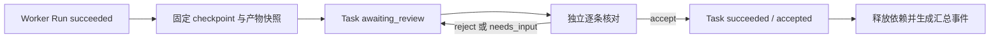

# 受管团队、交付验收与证据快照

更新：2026-11-19。本文描述已落地代码与云 TEST 契约；本批次服务端已部署生产镜像32eb39d8（2026-11-19），v0.2.0-preview.1安装包已公开发布，真实验收见实施状态。部署及真实模型/业务验收以[实施状态](implementation-status.md)为准。此处“团队”是产品层受管 Task 图，不代表已启用 Codex 原生 multi_agent。

## 任务图与授权

自由交办先由 Coordinator 澄清并提出计划，保存 `awaiting_confirmation` 后等待真实后续用户消息；确认和创建全部任务在同一事务内完成。模型不能生成确认消息，周期合成消息也不能充当确认。明确客户端 POST /tasks 保留结构化交办入口；设备不能借 POST /node/tasks 或旧 commit 绕过目标确认。

计划包含最多20个条目：`item_key/title/goal/deliverables/engine/device_id/model_id?`，以及 `depends_on_keys?`、`parent_item_key?`。唯一 item_key 在确认时原子映射成 Task ID。服务端验证本租户设备、指定电脑/引擎偏好、存在性、自引用、依赖环和父树环；父子关系表达归属，依赖关系决定执行顺序。已确认计划不能通过普通创建接口偷偷追加成员。

Task 暴露 `plan_id/parent_task_id/root_task_id/depends_on_task_ids/deliverables/delivery_status`。未就绪依赖令任务 `blocked`；只有所有依赖任务 `succeeded` 且 `delivery_status=accepted` 才进入队列。失败、取消、未知结果及未验收交付均不放行下游。Worker 接收 RunContext 中的已验收依赖结果和冻结产物引用，而不是重读可变的“最新结果”。

取消传播到受管子树和依赖后继。已被 accept 的 Run 进入 stopping 并等待实际静止；尚未 accept 的启动可作废。历史已完成结果保留。待确认计划取消会原子置 rejected/cancelled 并退出 pending；后到的旧确认返回冲突，dispatch 另有防御。取消意图持久保存，同 Run 使用新 message_id/producer_seq 重报成功也不能复活 Task、创建第二份交付或释放依赖。

## 执行完成与验收完成



Run succeeded 只证明执行循环报告结束；Task 成功需要独立验收。空标准默认一条“目标完成且有可核对结果”。Worker 的设备票据不能自行通过验收。

用户 GET `/v1/tasks/:id/evidence`，当前 Coordinator 设备 GET `/v1/assistant/tasks/:id/evidence`（带有效 X-Assistant-Epoch），均返回 TaskEvidence：

```text
{ task:Task, run:Run|null, delivery:TaskDelivery|null,
  deliverables:string[], result_text:string|null,
  checkpoint:{id,created_at}|null, evidence_error?:safe_code|null,
  steps:ToolStep[], artifacts:ArtifactMetadata[], reviews:TaskReview[] }
```

TaskDelivery 为 `{id,task_id,run_id,status,deliverables,checkpoint_id,artifact_ids,created_at,version}`。安全投影不含私有 scope、runtime binding、object key、凭据或票据。result_text 是报告数据，不单独构成已验证业务事实。

POST 对应 `/tasks/:id/reviews` 或 `/assistant/tasks/:id/reviews`，需 If-Match(Task.version) 与 Idempotency-Key：

```json
{
  "run_id": "<current-run-uuid>",
  "verdict": "accept",
  "summary": "按交付标准逐条核对",
  "checks": [{"deliverable_index": 0, "passed": true,
    "evidence_refs": [{"kind": "artifact", "id": "<artifact-uuid>"}]}]
}
```

verdict 可为 accept/reject/needs_input。标准索引不可重复或越界；accept 需覆盖全部标准、逐条通过且有证据。服务端核验引用属于同 Task/当前 Run、artifact 为 ready 且在交付快照内、checkpoint 恰为固定 completed checkpoint，不能引用任意字符串或其它任务。Coordinator 不能只重复 checkpoint。若本 Run 有成功的浏览器或记忆步骤，自动 accept 还要引用 ToolBroker 冻结的 `page_capture`、`screenshot` 或 `memory_retrieval`；成功步骤、Worker 报告和普通文件存在都不够。

节点的自动审核规则更严格：使用新的 runtime adapter，仅提供 delivery_evidence、artifact_read、review_submit 等只读工具；实际独立读取 server_snapshot 产物，每条通过标准关联真实读取的 artifact。不将 Worker 原文重新复述当作验收。legacy、未知来源、二进制、读取失败，或网站真实提交状态无法核实时，选择 needs_input 并转人工。拒绝或需补充不会自动重试有副作用操作。

## 不可变证据

检查点写入要求有效设备身份、当前 Run ticket、epoch 与租约，且 Run 仍 active/stopping；允许停止过程保存最后快照。首个 completed 内容 hash 冻结，同内容合法重放返回原 ID，不再写入新证据；不同内容或终态后写入拒绝。交付之后 evidence、结果展示与依赖读取固定 delivery.checkpoint_id 和 artifact_ids，不能用较晚记录替换已验收结果。

新文件先获得5分钟 staging PUT，finalize 在数据库行锁下 HEAD 获取大小/ETag，然后带签名条件 CopyObject 到随机独立 final key。源 If-Match 防止 HEAD→COPY 竞争；完整 CopyObject XML（包括 HTTP 200 内嵌 Error）及 final HEAD 校验通过才 ready。产品永不发出 final PUT；旧 staging URL 覆盖无法改变最终产物。ready 重复 finalize 不再复制。新产物投影 `integrity=server_snapshot` 与 finalized_at，历史 ready 明确 legacy_unverified，不静默重写已引用对象。客户端 sha256 只是 claim，未作为已验证摘要。

节点可读当前任务输入、历史 Run 产物及已验收依赖的冻结产物；finalize 仍限本 Run 上传。产物转移不带产品 Bearer，不自动跟随重定向，最大50MiB。私有证据的临时 GET URL不进入工具时间线或通知。

网页正文、截图清单和记忆检索引用是同一次交付里的普通产物，走上述冻结。捕获时间来自工具执行，不来自模型填写。截图保存不要求客户端先打开画面。记忆产物不包含无关公司记忆全文。旧 staging 地址不能替换已经 ready 的 final 对象。

ToolStep 仅保存 `{id,run_id,tool,title,status,started_at,completed_at,error_code,created_at,version}`。工具/标题白名单映射，未知工具为 other；状态含 result_unknown，安全错误码为 tool_failed/invalid_arguments/not_authorized/cancelled/result_unknown。参数、输出、页面、URL及原始错误不进入步骤数据库、公开事件和 GET；历史数据也经同样投影。页面原文在冻结产物里，不在步骤里。

## Coordinator 事件与恢复

事件类型为 delivery.submitted、delivery.rejected、task.failed、task.cancelled、task.result_unknown、plan.settled。CoordinatorEvent 含 id/type、可空 task_id/run_id/plan_id/delivery_id/source_message_id、status(pending/completed)、reason_code、created_at、version。

- GET `/assistant/events?status=pending` 补读持久队列。
- GET `/assistant/events/:id/context` 返回 `{event,source_message,plan:{id,summary,execution_status}|null,tasks:[{task,run,result_text}]}`；限定该计划全部最多20项（包含终态）或事件单任务。每份结果最多8k供摘要；独立核对需再读取 evidence/产物。
- POST `/assistant/events/:id/complete {message?,review_id?,follow_up_plan_id?}` 原子保存汇总与事件消费；要求至少一项结果，并验证 review/plan 归属。幂等键和内容 hash 防重复副作用。
- POST `/assistant/events/:id/usage` 接实际 request_key/usage_revision、engine/model/tokens/cost，归因 review/assistant 及事件关联 task/run，不虚构用户消息。
- POST `/assistant/plans {source_event_id}` 可提后续方案，和 source_message_id 互斥。继续使用 propose→真实用户确认，不自动重新执行副作用。

节点先将 review、summary、usage 出站写入 SQLite，再按 reviews→usage→complete 提交；重启补传沿同一身份去重。主助理规划在调用模型前持久记录running，usage回执实时落盘；模型失败保存通用回复，不因inbox或传输补读自动重复模型调用。重启发现未决running时要求真实用户明确重发，不能把未知执行当作可安全重试。Coordinator 离线或不能核实时，用户仍有 evidence/reviews 人工入口，任务不会因审核模型不可用而失去处理路径。

## 持久化与验证边界

002_team_orchestration.sql 新增组合租户约束的依赖边、交付、review、事件与唯一索引，全部 FORCE RLS。001保持冻结；已应用迁移由 owner 私有 name/checksum/applied_at ledger 管理，只执行未应用文件，已应用内容变化即失败。全局迁移独占 advisory gate 与所有租户事务共享 gate 互斥；图操作在行锁前取租户图锁，避免确认/取消/回报/派发竞争。

云 TEST 覆盖依赖放行、失败阻塞、取消传播、独立验收、事件费用/汇总幂等、工具元数据脱敏，以及不同 envelope 的取消复活/证据替换/取消前确认竞争回归。真实私有测试 S3 验证 A→finalize→旧 PUT 覆盖 B 后 final 仍 A、重放不重写、HEAD→COPY 源变化失败。所有测试均用专用云测试库/桶，未用生产或本地服务；模型与通知 provider 仍按各测试显式使用 fake/mock，不能把接口通过写成真实业务验收。
