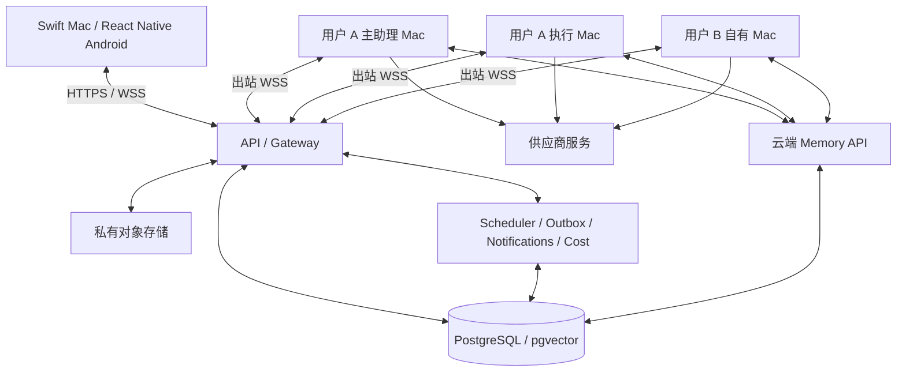
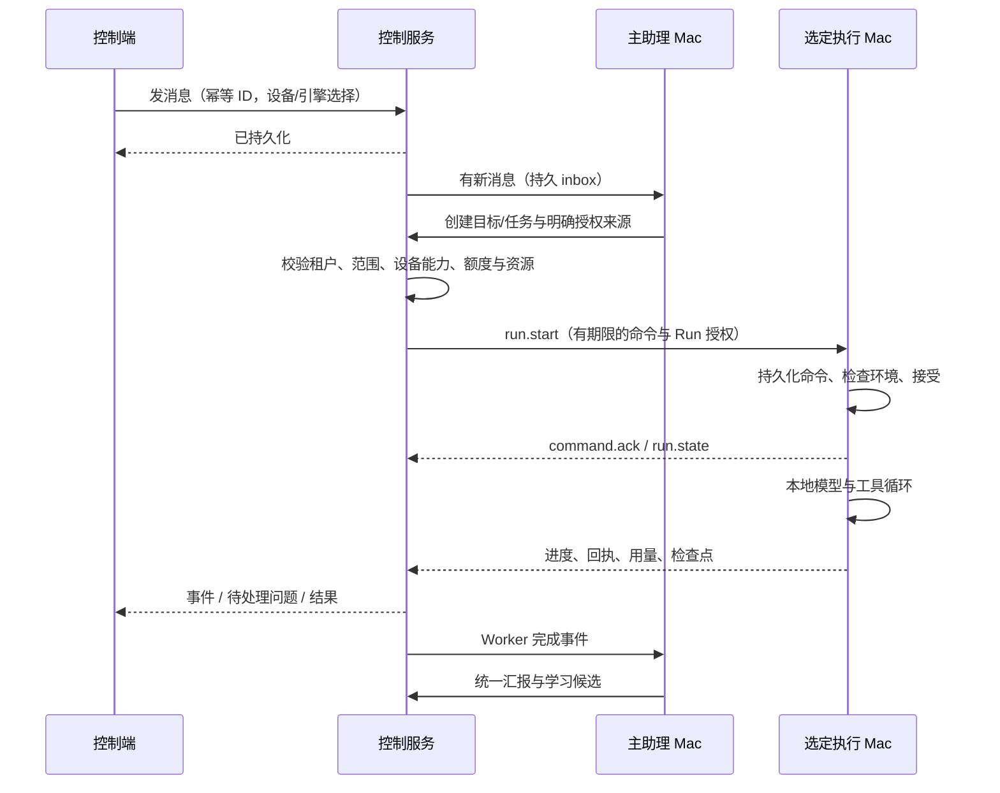

# 技术设计 v0.1

日期：2026-11-18。依据：[PRD](../tasks/prd-personal-super-agent.md)。接口详见[协议](protocol-v1.md)，开发顺序详见[实施计划](implementation-plan.md)。

## 1. 关键决策

实施更新（2026-11-18）：服务端实际路径为 `apps/control-server`，所有基础设施只在云端；记忆后端优先复用 `agent-recall`，每用户独立绑定，不另建向量服务。先前 embedding 自建选项仅为历史候选，不作为本轮实施依赖。当前资源和验证见 [实施状态](implementation-status.md)。

| 编号 | 决策 | 原因与代价 |
| --- | --- | --- |
| D-01 | 云端控制服务 + 用户 Mac 执行 | 复用本机登录态与凭据；智能能力依赖用户设备在线 |
| D-02 | 每用户一个个人租户，默认不跨用户共享 | 清晰隔离任务、记忆、设备和成本；组织协作另行设计 |
| D-03 | 引擎、模型、设备分别选择 | 一台电脑可配置多个引擎，能力与可用性按设备报告 |
| D-04 | 模块化单体与 PostgreSQL 持久队列 | 降低部署复杂度；多 Gateway 连接路由仍需持久唤醒与补读 |
| D-05 | 主助理是有租约的逻辑角色 | 一人多机仍保持一个对外助理；接任通过摘要重建上下文 |
| D-06 | 至少一次投递 + 去重 + 业务回执核验 | 网络不能保证端到端 exactly-once，尤其是网站提交 |
| D-07 | 运行中切换建立新的 Run | 保留产品任务连续性，承认原生会话和浏览器环境不可任意迁移 |
| D-08 | 供应商无关的记忆与用量契约 | 更换引擎仍复用知识与统计；适配器承担差异 |
| D-09 | 浏览器画面与控制事件分通道 | 慢图像与弱网不阻塞停止、提问和状态消息 |
| D-10 | 预算属于调度约束与尽力停止 | 已在途请求、原生引擎内部调用和订阅金额不可精确封顶 |

## 2. 系统拓扑与信任边界



Memory API 是同一服务的逻辑模块，不要求额外部署。API/Gateway 无任何 Codex/Grok 推理客户端和模型凭据表。供应商连接只出现在 Mac Runtime。对象、对话、被检索知识和画面仍进入受信任服务器，不宣称端到端保密。

### 2.1 云端模块

| 模块 | 负责 | 禁止承担 |
| --- | --- | --- |
| Identity | OIDC 映射、客户端会话、个人租户、邀请与角色 | 保存用户模型账号 |
| Device Registry | 配对、设备公钥、在线连接、能力快照、撤销 | 猜测电脑上的登录态可用性 |
| Conversation | 用户消息、任务关联、主助理租约、问题答案 | 调用模型理解消息 |
| Task/Run | 授权范围、状态迁移、Run、依赖和检查点 | 任意执行本机命令 |
| Dispatcher | 能力筛选、公平排队、资源租约、命令投递 | 自行扩大用户指定设备集合 |
| Memory | 教学资料、版本、检索、验证状态、失效 | 把网页指令升级为用户授权 |
| Artifacts/Media | 上传授权、私有下载、按需画面中继 | 暴露 Chrome/CSI 调试端口 |
| Usage/Budget | 用量归因、估算、去重、聚合、运行额度预留 | 用设备自报金额进行不可撤销扣款 |
| Automation | 定时与事件规则、去重、错过执行处理 | 所有电脑离线时执行模型任务 |
| Operations | 健康、告警、审计、独立受权成本聚合 | 默认浏览其他用户内容 |

### 2.2 Mac 节点模块

一个独立 `super-agent-node` 后台进程，建议用 TypeScript/Node.js 实现，便于复用协议与 Grok 工具循环。Swift 控制端负责首次设置、设备状态与用户操作；应用关闭不终止节点。

- `ConnectionManager`：设备认证、重连、命令确认、状态/用量补传。
- `CoordinatorHost`：持有本用户主助理租约时运行，轻量接待、创建任务、分派、总结；不等待耗时 Worker 同步返回。
- `WorkerHost`：每个 Run 固定执行引擎、模型、工作目录与权限快照，管理子任务。
- `RuntimeAdapter`：Codex app-server 或 Grok 本地 agent loop。
- `ToolBroker`：浏览器、记忆、文件、受控 shell、问题与任务工具的统一入口。
- `ResourceManager`：设备槽位、浏览器独占、人类接管模式、在途工具与控制 epoch。
- `LocalStore`：SQLite WAL，保存命令 inbox、事件/用量 outbox、检查点、运行映射和缓存版本。
- `MediaAgent`：指定标签页截图、按需推送、关键步骤证据与视口元数据。
- `CredentialResolver`：读取本机已配置账号/Key，只向对应本地运行时提供，不上传服务器。

节点由当前登录用户的 LaunchAgent 管理；Swift 安装向导取得所需用户级授权并注册启动项。不要以 root daemon 代替 GUI 会话。依赖 Chrome、CSI、Codex 和本机 Grok 配置的检查结果以脱敏能力快照上报。

## 3. 技术栈与仓库边界

建议 monorepo：

```text
apps/server/             Fastify API/Gateway、服务模块
apps/jobs/               调度、outbox、通知、聚合，复用 server domain
apps/node/               Mac 节点、运行时与本地工具
apps/macos/              SwiftUI，必要处 AppKit；独立 Xcode 工程
apps/android/            React Native + TypeScript；必要处 Kotlin
packages/protocol/       JSON Schema、事件目录、生成 TS/Swift 的输入
packages/domain/         不依赖 UI/供应商的状态与授权类型
packages/runtime-codex/  原生协议适配，不向客户端泄漏原始协议
packages/runtime-grok/   本地模型请求循环
packages/tool-broker/    工具契约、权限、租约、执行记录
db/migrations/           PostgreSQL DDL、RLS、索引与回滚策略
infra/                   镜像、反向代理、备份与部署配置
docs/                    当前设计和协议
```

这只是计划目录，本轮不创建业务代码骨架。原生 Swift 与 TypeScript 不共享 UI 实现，通过 schema 和兼容测试共享语义。Fastify 请求/响应 schema 来自可信仓库；模型生成的工具参数只当数据验证，不允许作为动态编译 schema。[Fastify 验证文档](https://github.com/fastify/fastify/blob/main/docs/Reference/Validation-and-Serialization.md)

## 4. 身份、配对与用户隔离

### 4.1 客户端登录

建议采用外置 OIDC 身份服务，已有公司/个人 IdP 可复用，没有则部署专用服务；实施 P1 前选定提供方，不在业务服务自行实现密码与 MFA。

Mac、Android 走系统浏览器的 Authorization Code + PKCE，验证 state/nonce 与回调绑定。禁止在嵌入式登录 WebView 中截取账号密码。[原生应用 OAuth 指南](https://www.rfc-editor.org/rfc/rfc8252)

客户端取得面向本 API audience 的上游 access token，经 `/v1/auth/exchange` 验证 issuer、audience、签名/内省及到期时间后，创建本产品会话。不能用一个只面向其他客户端的 ID token 充当 API 授权。

产品 access token 建议 10 分钟；刷新会话建议最多 30 天，旋转并检测重用，服务端仅存刷新凭证摘要。并发刷新由客户端串行化；刷新响应丢失的恢复策略在身份适配器中验证，不能把任意旧 token 永久作为宽限凭证。

每次读取高敏资源、发控制命令和 WS 订阅时校验会话撤销状态；退出、停用用户或撤销设备触发现存连接失效。Mac 用 Keychain；Android 用 Keystore 支持的安全存储封装，不把 token 放入 AsyncStorage。[React Native 安全文档](https://reactnative.dev/docs/security)

### 4.2 设备配对

1. 节点生成 Ed25519 设备密钥，私钥只留本机安全存储；设备 UUID 由配对完成时由服务器分配。
2. 节点申请短期 pairing session，提交公钥及一次性轮询秘密的摘要关联。返回给节点的展示码只标识待配对请求，不是长期凭据。
3. 已登录用户在控制端检查名称、公钥指纹摘要并认领；短码有 TTL、尝试限额且只能成功一次。建议 10 分钟 TTL，短码/二维码不写普通日志。
4. 节点用自己持有的 polling secret 取得认领结果；仅公钥绑定的私钥可完成后续挑战。攻击者猜到展示码不能取得已认领设备身份。
5. 后续 token 通过短期 nonce 挑战签名换取；签名绑定 origin、设备 ID、nonce、用途、协议版本。nonce 单次消费、服务器验时并防重放。

设备 access token 建议 5 分钟，声明 `principal_type=device`、tenant/device/key ID 与 scope。用户令牌不能伪装设备；设备令牌不能读取所有用户数据。设备公钥轮换需要旧钥证明或已登录用户重新配对。

撤销先禁用设备身份与所有 Run/资源租约，关闭连接、停止新派发，令本机进入停机核对模式。物理设备转让由节点侧清理原用户配置；服务器不能声称已远程擦除离线硬盘。

### 4.3 Run 级授权

节点持有设备身份，具体工具访问还必须携带 run ticket，绑定 tenant、task、run、device、lease epoch、scope version、expiry。建议有效期不超过 60 秒，由节点续租刷新。

服务器从已验证身份决定租户，忽略模型和请求正文声称的 owner。主助理只可用其 coordinator scope 管理本用户任务；Worker 只读任务允许的记忆/文件并汇报自己 Run，不能用设备身份枚举本用户全部私密项目。

### 4.4 数据隔离

每个人一个 personal tenant；所有业务表有 `tenant_id`，账户映射/邀请/公共模型元数据等控制表单独授权。跨表外键用 `(tenant_id, id)`，避免 A 的 Task 引用 B 的 Device。

RLS 同时限制读和写。示意：

```sql
ALTER TABLE tasks ENABLE ROW LEVEL SECURITY;
ALTER TABLE tasks FORCE ROW LEVEL SECURITY;
CREATE POLICY task_tenant_policy ON tasks
  USING (tenant_id = NULLIF(current_setting('app.tenant_id', true), '')::uuid)
  WITH CHECK (tenant_id = NULLIF(current_setting('app.tenant_id', true), '')::uuid);
```

服务通过已授权的事务 `SELECT set_config('app.tenant_id', $1, true)` 设置上下文；缺失时默认拒绝，连接池复用不能沿用上一租户。所有应用查询使用无 superuser/BYPASSRLS 的非表所有者角色，DDL 身份不用于请求。RLS 不替代 API 授权，也不能隔离已控制数据库的管理员。[PostgreSQL RLS 文档](https://www.postgresql.org/docs/current/ddl-rowsecurity.html)

后台全局调度只读取不含消息正文的全局候选索引，获取租户 ID 后进入对应租户事务处理。跨租户聚合使用独立窄权限函数/角色，仅输出受权字段，不能为便捷给普通服务连接 BYPASSRLS。

缓存键、幂等键、锁、向量搜索、事件补读、媒体订阅、对象路径和通知收件人都包含或验证租户。向量检索在被授权候选集内进行，不能先取全库 top-k 再在客户端过滤。

## 5. 核心数据模型

统一 UUID；时间戳 UTC `timestamptz`；用户时区另存。money 用 `numeric` 或整数 ticks，网络用十进制字符串；数据库 bigint 在网络上也用字符串。下列 ID 均需租户内唯一索引与组合外键；细节在首批 migration 固定。

| 表 | 关键字段 / 约束 |
| --- | --- |
| users / personal_tenants | OIDC `(issuer, subject)` 唯一；用户一对一 tenant；状态与时区 |
| client_sessions | user、refresh digest、family、expires/revoked；不存模型账号 |
| device_pairings / devices | 配对秘密摘要、公钥、owner、key version、revoked；physical binding 默认单用户 |
| device_capability_snapshots | device、generation、engines/models、tools、capacity、ready state、observed_at；无密钥 |
| device_connections | device、connection generation、gateway、last_seen；过期即不再用于派发 |
| assistant_leases | 每 tenant 一行；device、epoch、expires_at、last_message_seq |
| assistant_inbox / plans / plan_items | 原始输入事件、服务器分配 plan ID、草案版本、稳定 item key、提交结果；来源与已创建 Task 可追溯 |
| threads / messages | assistant/task thread、role、content refs、client_message_id、tenant sequence |
| tasks / task_scope_versions | goal、deliverables、scope source、required capabilities、desired device、version、status/reason |
| runs | task、parent/root run、role、device、runtime/model snapshot、scope version、epoch、state、timestamps |
| runtime_bindings | run → 本机原生 thread/turn/response 的引用；不包含认证凭据 |
| steps / tool_attempts | run、tool call identity、normalized intent、input ref、started/finished、receipt、outcome certainty |
| questions / answers | task/run、question version、state、answer、answered_by；每问题版本最多一个生效答案 |
| commands / device_inbox_receipts | command ID、device/run/epoch、expiry、payload hash、delivery/accept/result；逻辑命令唯一 |
| events / outbox | tenant cursor、event ID、producer ID/seq、type、payload；同事务写入状态变化与 outbox |
| resource_leases | tenant、resource key、holder run/client、epoch、expires；同资源单持有者 |
| checkpoints | run、schema version、goal/scope refs、completed receipts、pending uncertainty、artifacts/memory refs、hash |
| artifacts | owner、run、object key、size/hash、mime、upload status、retention；上传先 staged 再 finalize |
| memory_items / memory_versions / memory_chunks | type、subject/site、current version、status、source refs、embedding generation |
| schedules / triggers | owner、scope、timezone、next_due、dedupe key、catchup policy；触发唯一 |
| notifications / notification_deliveries | durable inbox、target client、attempt、provider result；通知本身不含机密正文 |
| usage_records / usage_revisions | run/request identity、category、token classification、currency/amount/source/quality、revision |
| price_versions / budget_accounts / budget_reservations | 生效日期、费率；租户预算与按 Run 的额度预留 |
| usage_daily_rollups / audit_events | 可重建聚合；敏感动作、身份和运维访问审计 |

建议索引：任务 `(tenant_id, updated_at, id)`、Run `(tenant_id, device_id, state)`、命令 `(device_id, state, expires_at)`、事件 `(tenant_id, stream_seq)`、用量 `(tenant_id, occurred_at, run_id)`、记忆 `(tenant_id, type, subject_id, status)`；向量索引按租户/过滤后的效果和规模实测。

`events` 的租户流序号由一个短事务锁定的 `tenant_stream_counters` 行递增后分配，直到提交才释放；批量一次分配连续区间。不能直接把普通全局 sequence 当作按提交顺序可补读的游标，否则并发事务晚提交会造成漏读。图像帧不进入此序列，减小锁热点。

协议源与数据库 migration 分工：migration 决定持久化约束；JSON Schema 决定线上的输入输出；枚举和值域由 protocol 包生成，禁止在 Swift、TS、DDL 中手工漂移。

## 6. 消息、调度与恢复

### 6.1 一条交办如何执行



明确交办的授权来源关联原始用户消息。主助理的任务创建调用不能伪造用户确认；扩权必须引用服务器记录的有效确认或周期规则。产品验证目标与实际交付，模型回合结束不直接设置 Task 为完成。

### 6.2 调度和公平性

Job 进程按租户轮转候选，对每租户设置并发、队列和主动任务额度，再选择设备。明确指定设备只派该设备；自动模式只筛选已授权集合。心跳建议 10 秒一次，30 秒无有效心跳判定 unavailable；界面 60 秒内显示离线。参数可配置并经弱网测试调整。

用短数据库事务取得候选（队列可用 `FOR UPDATE SKIP LOCKED`）、锁定任务与设备资源、预留 Run 额度、固定配置、写命令与 outbox，再提交；网络投递在事务外执行。禁止持有行锁等待模型或设备响应。[PostgreSQL 锁说明](https://www.postgresql.org/docs/current/sql-select.html)

设备在接收时再次检查本机引擎、登录态和工具。设备接受命令不是已完成任务；收到 `running` 才表示 Runtime 已开始。重复命令返回原有接受状态，不新建原生会话。

### 6.3 租约与在途动作

Run/浏览器控制租约建议 45 秒、10 秒续租；每次持有者变化递增 epoch。节点用服务器返回剩余期限建立本地单调时钟 deadline，不能只信本地系统时间。

网关与节点两侧核验 epoch。租约失效立即拒绝新的受管工具、停止派发新模型轮次，并请求原生引擎中断；正在执行的动作记录 outcome unknown。网站不支持 fencing token，因此租约过期不能证明旧点击/提交没有发生。新执行遇到相同业务对象必须先查询回执；无法核验时阻塞为 `result_unknown`。

全权限 shell 与原生后台进程不受纯工具协议的绝对约束。初版不自动放行同一资源的新 Worker，直到旧 Runtime/受管子任务停止且结果已核对；无法确定时请求人工处理。安全保证覆盖产品受管通道，不声称控制恶意或完全绕过节点的任意本机程序。

### 6.4 主助理不中断接待

Coordinator 的工具是 `task.start/status/steer/cancel` 等异步操作：启动只返回 Task/Run ID；完成通过持久事件投递。它不能长时间同步等待 Worker 或等待浏览器锁；同机 Worker 占用浏览器时，主助理仍可处理对话。

对用户消息和主动触发采用持久 assistant inbox。处理前取得服务器分配的 plan ID；提交规划时将稳定 plan item key、scope 来源、Task 创建和来源事件消费标记放入同一事务。`(tenant_id, plan_id, item_key)` 唯一，恢复后先读取已有计划/Task，再继续处理。网络丢失后的重复提交返回原结果，不能仅凭模型重新生成一个新 UUID 就绕过任务去重。用户明确改变目标产生新的计划版本，不能修改已执行步骤的历史事实。

同一租户只有一个有效 coordinator lease。接任递增 epoch，新实例从云端摘要、消息游标和关联任务恢复；旧主助理输出带旧 epoch，被服务端拒绝。建议首版手动接任，自动接任作为显式可开关策略，验收独占性后开放。

### 6.5 断线重连

SQLite inbox 先写入命令再确认；outbox 先写事件再发。服务器 ACK 只在事务提交后发送。本机按 producer sequence 重传未确认记录，服务端按 `(tenant, producer_id, producer_seq)` 与 event ID 去重并比对 hash；同 ID 不同 payload 返回冲突。

重连先建立新 connection generation，发送活跃 Run 清单、最后已确认游标和原生运行状态，再逐个 reconcile。旧连接关闭且无法再接收新命令；旧历史日志可补传，但不能用历史状态消息恢复旧执行权限。

任务状态更新按目标 Run、epoch、局部顺序与状态机校验。过期 Run 的晚到终态可进入历史记录和费用账本，不能把当前新 Run 误标为完成。

## 7. 引擎适配与子任务

统一接口为产品接口，不是供应商原生 API：

```ts
interface RuntimeAdapter {
  probe(): Promise<Capabilities>;
  start(context: RunContext): Promise<RuntimeHandle>;
  deliver(input: UserInput | ToolResult): Promise<DeliveryResult>;
  requestStop(reason: StopReason): Promise<StopReceipt>;
  reconcile(binding: RuntimeBinding): Promise<RuntimeStatus>;
  events(): AsyncIterable<RuntimeEvent>;
}
```

暂停不是把 JS 异步迭代器暂停：Host 先关新调用闸门，再发 runtime stop，等待在途工具、受管进程与原生回合状态。`StopReceipt` 区分 requested / quiesced / uncertain。只有 quiesced 且业务结果明确才允许交接资源。

### 7.1 Codex

使用本机 `codex app-server` 的 stdio JSON-RPC，不开放公网监听。默认复用用户已有登录，项目级配置给本产品会话挂载受管工具，不覆盖用户全局配置或复制认证文件到云端。

Runtime Host 负责 initialize/initialized、thread/start 或 resume、turn/start、turn/steer、turn/interrupt，以及问题/批准响应与事件归一化。`turn/steer` 使用 expectedTurnId；无活跃回合时转为下一回合输入，不静默丢弃。[官方 app-server 文档](https://learn.chatgpt.com/docs/app-server)

2026-11-18 本机 `codex-cli 0.170.0` 的非实验 schema 已核实：存在 ThreadStartParams、TurnStartParams、TurnSteerParams、TurnInterruptParams 与 ThreadTokenUsageUpdatedNotification。ThreadStart 支持 cwd/config/developerInstructions；不能由此推断所有实验工具配置或原生子 Agent 行为都已可用。M0 从目标二进制生成 schema，保存版本/hash 并做握手与真实能力测试。

每台设备的本产品工作目录独立，按 task/run 划分文件。进程可承载多个线程，隔离与取消传播需 M0 测试；有互相干扰则采用独立 app-server 实例或限制每设备活跃会话数。不要把多会话当作 OS 安全沙箱。

### 7.2 Grok

本地 Runtime 用用户已有 Key 直连 xAI，发送工具定义，校验 tool call 参数，调用本地 ToolBroker，回传结果后继续。上下文在本地保存；使用服务器侧 response 引用时记录可用性与过期情况，恢复不假设供应商永远保存历史。[官方 function calling](https://docs.x.ai/developers/tools/function-calling)

首版不强制引入新的 agent 框架；先用官方接口支持的最小循环，实现工具调用上限、响应上限、超时、429/5xx 退避、终止、问题与用量。工具 schema 由公共注册表产生，凭据不会放入工具参数。

截图输入依赖所选模型的图片能力；模型列表以本机探测结果为主，不能在控制端编造可用模型。服务器可保留公共模型元数据与费率，不持有 Key 去探测账号。

### 7.3 子任务

产品层受管子 Worker 承担跨引擎/跨设备拆解；默认继承根任务范围与预算，不得扩权。原生 Subagent 作为适配器内优化，需可追踪父子、计量与停止；无法可靠管控时不用于持有浏览器等共享写资源。

每 Run 固定 `root_run_id`、`parent_run_id`、`role`。限制总深度、并发与总 Run 数，建议初值深度 2、每任务并发 3、每设备浏览器 1；这些是调度配置，不宣称供应商限制。父任务取消或切换协调全部受管后代，不只停止最上层模型流。

### 7.4 引擎/设备切换

1. 校验 task version、目标引擎/设备能力和授权范围。
2. 设 `switching`，撤销旧 Run 新工具资格并请求停止受管树。
3. 处理在途工具；提交不明则进入核对，保留切换请求。
4. 生成并持久化 checkpoint，检查引用归属与文件是否已上传。
5. 新事务释放旧租约、固定新 Run、预留额度、写启动命令。
6. 新 Worker 读取目标/检查点/记忆，重查页面与依赖，继续未完成步骤。

检查点由执行日志和结构化输出构成，不要求依赖旧模型在被中断后再生成一次总结。文件清单指向私有 artifact；跨设备传输只针对用户允许上传的任务文件，缺少文件则等待处理。

## 8. 浏览器、画面与人工接管

CSI 仅本机访问，通过独立服务 adapter 发送命令。一个 Run 使用一个 CSI session/tab group；本机初版所有修改浏览器当前页/焦点的操作串行化。session/tab group 不能提供浏览器 profile 隔离。

截图采集也进入同一 BrowserActor 队列，绑定实际 tab/session。不能一边截图切换 current tab，一边让另一个动作依赖旧焦点。每次导航、点击和读取记录目标 tab、操作意图、观测版本及证据引用。

画面建议 JPEG、1 fps 默认、最多 2 fps、最长边 1280、质量 60–70，按设备和网络动态调整。都是待测参数。按需授权 viewer，未观看时只保留关键步骤截图。帧携带 `view_id/tab_id/frame_id/viewport_version/captured_at`，不写入持久事件流。

用户接管先暂停相关 Run，取得 human control lease；输入引用当前 frame/viewport version，用坐标映射或受支持的键盘事件送回本机。过时帧、越界坐标和过期 lease 拒绝并请求刷新。第一版不实现任意系统按键或安全弹窗控制。

人工 lease 过期后停止输入，任务保持 paused，不能自动把尚未完成的人类操作交回 Agent。用户明确继续后重新观测页面并取得 agent lease。一个 viewer 只有查看权限不自动取得输入权限。

媒体连接有单独限速和最新帧队列，慢消费者丢旧帧；控制通道有大小限制和心跳优先级。服务器终止 TLS 的画面可见性纳入数据边界；签名 URL、票据和画面不进入访问日志。

## 9. 云端记忆与学习

统一工具：`memory.search`、`memory.read`、`memory.propose`。Codex 用本地 MCP，Grok 用 function calling 转接同一 adapter。run ticket 控制租户、项目与对象范围，不因模型换引擎而变化。

启动预取：本次目标、必要用户偏好、相关网站档案摘要和引用；执行中按需召回。首次进入已登记网站，BrowserActor 可触发档案加载并把结果交给当前运行时；模型尚未消费结果前不放行依赖该流程的下一步受管操作。

记忆后端复用现有云端 agent-recall。每用户在控制端绑定自己的 Recall URL、PAT 和可选 project；服务端验证 `/api/auth/me`，把绑定账号与产品租户一一关联，PAT 使用独立稳定密钥 AES-GCM 加密、tenant 作为 AAD，数据库强制 RLS。URL 只能来自管理员允许的 HTTPS origin，禁止跟随重定向；不存在全局个人 PAT 回退。

Recall 负责正式内容、版本链与搜索，产品 PG 保存绑定、候选提案、标题/网站等元数据；节点不获取 Recall PAT。工具请求先验证产品设备与当前 run ticket，再在租户事务内调用 `/api/memories/recall` 或单条读取，返回 top-5 可续读结果。没有绑定时明确提示配置，不能悄悄查询开发者账号。复用 Recall 当前检索能力，不新增 embedding、ES、Redis 或 pgvector 部署依赖。

提案包含来源、事实/推断、验证证据；原文与已验证流程分版本保存。网页内容不产生授权记录。明确用户纠错比历史推断优先，失效版本退出新召回，相关活跃 Run 收到 memory invalidation 后重新读取。

本地缓存有界，key 包含 tenant、任务 scope、memory ID/version、index generation；离线返回 observed_at 与 stale 标记。依赖当前授权或业务实时状态的动作不能靠过期缓存放行。删除先置 tombstone、取消索引可见性，再异步清理 chunks/对象；备份按保留周期过期，不承诺修改已不可变的历史备份。

## 10. 用量、费用与预算

### 10.1 采集与归因

主助理、Worker、受管 Subagent、失败重试、主动扫描分别记录。每条记录关联 tenant/device/run、原始请求/回合 ID、独立 attempt、模型、用途和费用来源。无独立任务的主助理 Run 仍有 role/category，归入“助理运行”。

Grok 返回的 `usage.cost_in_usd_ticks` 为该请求供应商金额，已含该请求内服务端工具费用，不能重复加工具费；完整多轮本地循环按每次请求分别记账。流式累计或最终值按 request ID 更新，而非每个 chunk 累加。[费用字段说明](https://docs.x.ai/developers/cost-tracking)

Codex 原生 Token 事件可能是会话累计快照。适配器以原生 thread、counter generation、turn 边界保存 watermark，产生可幂等更新的用量记录；新 session/reset 开新 generation，不对负差值直接取绝对值。M0 核实缓存/推理/子 Agent 覆盖范围；只计一次最细的可用叶子记录。只有父级总额时保留 aggregate-only，子级展示 unknown，不能凭猜测拆分。

每个逻辑消费记录有单调 revision、payload hash 和 source quality。先估算后收到供应商金额是替换有效版本，账本保留历史修订；聚合按差额更新或从有效版本重建，不能把两版费用叠加。

### 10.2 大盘口径

费用分四类：`provider_reported`、`estimated`、`user_entered`、`unknown`。供应商金额仍是设备转报，单列 `verification=device_reported`，不冒充服务器独立核账结果。

金额保留原币种和精度，估算保存费率生效版本。Token 分类需区分是否包含子分类，缓存 token 不重复计算，reasoning 是否已经计入 output 遵循对应供应商口径。订阅月费可由用户录入并单列，不使用 API 单价伪造单任务现金成本。

按用户时区生成日/月视图，支持 UTC 明细导出。图表同时返回已知费用、未知请求数、来源覆盖率与最后采集时间。模型/任务、设备/项目维度的筛选都在同一有效记录集内计算，不把父任务合计再次加入总和。

### 10.3 预算的可执行边界

云端以 Run 为粒度原子预留用户月额度、任务额度与主动任务额度，节点持有有 TTL 的 budget grant；多机启动不会重复使用同一剩余额度。grant 定义金额/Token/运行时长/工具轮次等可用限制，未知金额不当作零消费。

Grok 本地循环能在下一次模型请求前检查 grant 与已知用量，约束 max output/工具轮次，必要时申请增量额度。Codex 内部模型调用由原生 harness 管理，Host 主要监控 Token、时间、用量事件与中断，不能声称每次内部请求都经过我们的逐请求预扣。

额度过期、无法续租或超预算时停止新受管轮次并尽力中断当前运行；已发出的模型/工具请求可能继续计费，金额缺失时只能执行 Token/时长等替代约束。全权限用户本机还能自行绕开产品，个人预算不构成供应商账户硬额度。

## 11. 主动任务与通知

本轮实现范围：定时关注采用 `remind_and_confirm`，支持用户创建、启停、删除与按间隔触发；触发送入主助理，生成目标/产出/执行位置摘要，用户确认后才执行。自动写入业务网站、复杂静默窗口和厂商后台推送不因存在规则而默认启用；以下描述为后续完整能力目标。

规则版本包含观察范围、行动权限、频率、时区、静默时段、成本上限和有效期。服务器只做确定性时间/来源过滤与触发去重，语义判断送主助理 Mac；不对每条环境事件都调用模型。

`(schedule_id, scheduled_occurrence)` 唯一。错过执行默认 coalesce 为最近一次，过期事项跳过并记录；DST 对重复/不存在本地时间的处理要固定规则。触发时仍检查规则是否有效、用户预算和设备就绪状态。

问题先持久化，再经通知投递；通知深链只带对象 ID，进入后鉴权。Android 前台 WSS 与后台推送分工，不能依靠后台 JS 定时保活。FCM/国内厂商通道按目标手机与网络 M0 实测，选一个满足首批设备的主通道；Mac APNs 依赖签名和开发者配置。

通知 outbox 至少一次，客户端按 notification ID 去重。provider 接受不等于用户已读；分别记录 accepted / delivered（如可得）/ opened / actioned。静默时段不抑制用户主动交互，紧急打扰必须有显式规则。

## 12. 部署、容量与运维

初版部署：反向代理 + 控制 API/持久调度 + PostgreSQL + 私有对象存储 + 既有 agent-recall；OIDC 与推送接外部服务或独立部署。当前事件、命令和截图使用持久 REST 轮询与私有 S3；WSS 作为后续传输优化，不把尚未实现的通道写入客户端必要路径。所有服务端镜像在云端构建和运行，开发 Mac 不启动 Docker 或数据库。

多 API 实例通过 connection registry 找到 device 的当前 gateway。命令始终先持久化，目标 Gateway 用短轮询补读，LISTEN/NOTIFY 仅加速唤醒，通知丢失不丢任务；payload 只含引用、无敏感正文。禁止把 NOTIFY 当持久消息队列。[PostgreSQL NOTIFY](https://www.postgresql.org/docs/current/sql-notify.html)

建议初始调度器/命令扫描间隔 1 秒、满队列批量投递、带抖动的指数退避。服务升级停止新派发、完成 DB 兼容迁移、等待正在处理事务退出，设备依赖 outbox 补传恢复。DB outage 时拒绝新的控制变更，不向客户端谎报成功。

| 项目 | 首轮压测假设，待用户规模确认 |
| --- | --- |
| 注册用户 / 同时活跃用户 | 20 / 10 |
| 配对设备 / 在线设备 | 60 / 30 |
| 同时执行 Run | 20（设备及用户额度继续约束） |
| 同时画面订阅 | 5，1 fps，每帧约 100 KB 的测算值 |
| 画面出口量级 | 约 4 Mbps，不含 TLS/重传；真实页面需实测 |

4 vCPU / 8 GB 只作为上述小规模控制服务的试运行起点，不是性能结论。截图/文件对象存储与数据库卷分开。关键截图建议 7 天、普通运行事件 30 天、任务结果和记忆长期保留可配置；用量聚合/审计保留期上线前确认，不隐式无限留存全部页面。

备份建议 PostgreSQL 日备 + WAL/PITR、对象存储版本/生命周期，备份加密并定期恢复演练。首轮恢复目标建议 RPO ≤15 分钟、RTO ≤4 小时，只有备份与恢复实测后才能标记达标。灾后恢复强制轮换设备连接 generation、重新 reconcile 活跃 Run，不能重复启动所有“执行中”记录。

指标：队列等待、命令 ACK 延迟、事件端到端延迟、活跃 Run、失联设备、在途工具、outbox 积压、事件冲突、费用覆盖率、预算偏差、画面丢帧、通知接受率与越权拒绝。trace 关联 command/run/task，默认日志无对话正文、Cookie、Key、完整页面与票据。

节点 Watchdog 先检查进程、心跳、重复调用、最后业务进展和额度；有限重试后转需处理。单纯有 CPU/Token 活动不能代表有效进展；模型诊断也必须在本用户在线 Mac 上运行并计入用量。

## 13. 尚需验证的决策与退出条件

| 项目 | 不确定性 | M0/P1 退出条件 |
| --- | --- | --- |
| Codex 工具/子 Agent | 配置可见性、取消传播、使用统计口径 | 目标版本可观测并可停止；否则关闭受影响优化 |
| Grok 本机配置 | Key 获取位置、模型、图片/工具能力 | 明确本机配置契约、最小闭环与费用样本 |
| CSI 接管 | 当前 session/focus、验证码、iframe、系统弹窗 | 在真实目标网站通过三类工作样本；明确不可操作部分 |
| OIDC | 尚无指定服务 | 选定 IdP，真机 PKCE/退出/刷新/撤销通过 |
| 推送 | 手机厂商、国内网络、APNs 签名 | 目标手机杀进程/弱网与 Mac 关闭窗口后通知通过 |
| embedding | 模型、部署位置、数据许可 | 独立批准并锁定 generation；未满足时明确使用关键词检索 |
| 实际业务 | 三个首发场景尚未提供 | 给出样本、成功判据、允许行动和异常回执 |

这些条件影响具体能力是否开放，不阻塞身份、队列、协议和数据隔离等独立模块的设计与实现准备。
