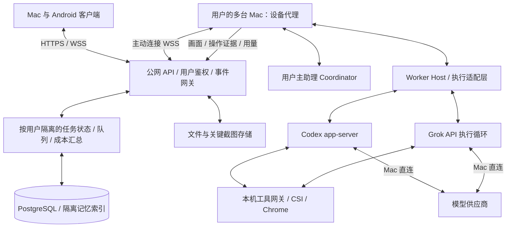

# Personal Super-agent：产品目标与实现方案 v0.3

日期：2026-11-18。状态：完整产品目标基线，已有基础预览版；实际完成情况和缺口以 [实施状态](../docs/implementation-status.md) 为准，不将本文件全部目标视为已交付。

整体架构已获用户认可，当前进入技术方案细化。设计入口见 [技术方案目录](../docs/README.md)。后续实现以技术设计与版本化协议为准，供应商能力通过原型验证后开放。

实施更新（2026-11-19）：用户已选择自由聊天先确认目标方案，结构化任务表单提交即明确授权。当前周期规则仅“提醒并确认后执行”；下文的一次规则授权后自动运行、完整团队调度和持续主动学习仍属于目标能力，尚未全部实现。

## 1. 产品定位与已确认事项

为多个彼此隔离的用户分别提供持续在线的私人助理团队。每个用户通过独立的 Mac、Android 应用与自己的助理沟通，管理多台执行 Mac，选择执行引擎与具体电脑。助理理解交办目标后，自主调用工具、调度 Worker 和 Subagent 完成任务，提供过程证据、结果、长期记忆与成本统计。

已确认：

- 执行设备为独立 macOS 电脑，具备用户工作所需的权限、登录态和内网访问能力。
- 用户入口为独立 Mac 应用和 Android 应用，不要求日常操作远程终端。
- Mac 控制端使用 Swift；Android 控制端使用 React Native。执行节点代理是独立组件，不与客户端进程绑定。
- 首版支持 Codex 与 Grok 两类 Worker，用户可在控制端切换。
- 首版支持多个用户，服务端按用户隔离；每个用户可配对多台执行 Mac，派活时选择具体电脑。
- 每个用户的 Codex 账号、Grok API Key 均在其 Mac 上预先配置；模型调用由 Mac 直连供应商，服务器不接收模型凭据、不代理模型请求。
- 控制端提供成本大盘，按任务、电脑、引擎和时间查看用量及费用；用户只看自己，平台管理视图单独授权。
- 先支持浏览器操作与画面查看，后续扩展其他 App。
- 必须鉴权；执行电脑没有公网 IP，可以提供公网服务器。
- 支持网站知识、工作经验与个人偏好的长期记忆。
- 支持主动提醒、建议，希望越用越懂用户。
- 当前阶段确定产品目标、功能、实现方案，不开始搭建完整业务系统。

尚待用户补充：最有价值的三个真实工作场景、具体行动边界。下文的巡检、查资料、报告均为设计示例，不视为用户已授权执行这些工作。

交互默认建议：明确交办的任务直接执行，只有目标不清、需要业务判断或扩大授权范围时再询问；用户也可以选择更严格的“先确认再执行”模式。该默认策略尚待真实场景检验，不把额外确认作为所有任务的必经步骤。

## 2. 产品目标

1. 用户能够在任一客户端交办任务、补充要求、回答问题和验收结果，跨端保持一致。
2. 耗时任务执行时仍能接收新消息、新任务；用户无需管理底层模型 Session。
3. 用户能随时知道任务处于什么状态、最近完成了什么、下一步是什么、是否需要自己处理。
4. 浏览器任务可查看当前页面画面和关键步骤证据；用户能暂停后接管。
5. 应用关闭后后台任务继续；系统重启和网络中断后任务状态可追踪、可恢复。
6. 同类任务能复用网站知识和已验证流程；错误经验不会未经验证成为长期规则。
7. 主动行为有明确来源、理由、频率和成本边界，能够被用户关闭。
8. 用户可在控制端选择 Codex 或 Grok Worker；更换后复用同一套任务记录、记忆和执行工具。
9. 每个用户拥有独立助理上下文、记忆、任务、文件、设备及成本数据；跨用户请求不能访问或操作其他用户资源。
10. 每个用户能选择执行电脑，查看设备在线状态、工具能力和任务负载，并在成本大盘追溯消费来源。

24 小时指控制服务持续可用、消息可接收、状态可查询；智能回复与执行依赖该用户至少一台合适的 Mac 在线。所有电脑离线时仅接收消息、保存状态和排队，不声称能继续规划或操作浏览器。

## 3. 核心交互

### 3.1 主入口：一个助理，多个任务

默认展示当前用户自己的统一助理对话。底层可以有许多模型会话，产品只向用户展示任务、项目、决策和结果；不同用户不共享助理上下文。

Mac：左侧任务与项目，中间对话与任务时间线，右侧可展开浏览器画面、资料和交付物。

Android：对话、任务、待我处理、记忆为主要入口，设备与成本大盘可从导航进入；任务详情内查看步骤、画面和文件。布局适配手机，不直接缩小 Mac 界面。

在任务详情中发消息天然关联该任务。全局消息无法可靠归属时，以任务选择卡片澄清，不默默修改另一个任务。

### 3.1.1 Worker 选择与切换

Mac 与 Android 提供一致的设置语义：

- 全局默认 Worker：Codex 或 Grok；变更只影响之后创建且没有单独指定 Worker 的任务。
- 创建任务可覆盖默认值，显示已配置的模型、可用状态和所需能力；具体模型 ID 由服务端维护，不写死在客户端。
- 任务详情展示当前 Worker、实际模型、设备和当前 Run，可选择“切换 Worker 并继续”。
- 尚未开始的任务直接改执行配置；已运行的任务先暂停旧执行、等待在途工具结果明确、保存检查点并撤销旧控制租约，再创建使用新 Worker 的 Run。
- 接续资料包含原始目标、用户补充、行动范围、记忆引用、已完成步骤与回执、当前环境、未解决问题和下一步；不要求迁移供应商内部推理或私有会话状态。
- 无法核实在途提交结果时，先进入“结果待核对”，不同时启动新 Worker。
- 能力不匹配或凭据不可用时显示具体原因，不默默换供应商；自动故障切换可后续单独配置。
- 默认 Worker 设置与运行中切换由服务端持久化，两端使用版本校验避免并发修改覆盖。

首版控制端切换的是执行 Worker；统一助理 Coordinator 的模型配置保持独立。Grok 先按官方 API 接入进行设计，若后续要求特定 Grok CLI，则新增对应运行时适配器。

### 3.1.2 执行电脑与主助理电脑

控制端区分引擎与设备两个独立选择：例如“Grok + 办公室 Mac mini”或“Codex + 家中 Mac Studio”。一台电脑可以支持两种引擎，也可以只配置其中一种。

- 设备列表只返回当前用户自己的电脑，显示名称、在线/忙碌状态、引擎是否可用、浏览器与内网能力、标签及并发容量。
- 用户可指定默认执行电脑；每次派活可覆盖选择。任务摘要与详情显示具体执行电脑。
- 明确指定的电脑离线或缺少能力时，提示原因并排队等待该电脑，或由用户改选；不默默换到另一台。
- 可选自动分配模式仅在本用户明确允许的电脑集合内，根据任务所需内网、网站登录态、工具能力、引擎与空闲容量选择。运行开始后固定该 Run 的 device_id。
- 同一任务有多个可独立执行的子任务时，允许在同一用户的多台电脑并行，记录每个子 Run 的执行电脑和成本；依赖特定页面或登录态的子任务绑定原设备。
- 运行中改电脑使用检查点交接，并检查目标电脑的文件、网站登录态与环境。云端记忆可复用，原设备的浏览器状态、Cookie、Keychain 和本地文件不自动迁移。
- 默认一台物理执行电脑只归一个用户；解绑或转移前撤销在途任务及设备身份，并在设备侧清理旧用户缓存与凭据。

每个用户另外指定一台“主助理电脑”运行逻辑 Coordinator，默认可与执行电脑相同。自然语言理解、任务拆解与汇总均使用该电脑已有的模型配置。需要其他电脑执行时，经云端任务队列分派，不向其传递主助理电脑的模型凭据。

主助理电脑离线时，服务器保存新消息并显示等待状态。用户可以改选自己的另一台已配置电脑接任；若启用自动接任，也必须限定候选设备并用独占租约防止两个 Coordinator 同时回应。同一用户的主助理接任读取云端任务摘要与记忆，不能假设原生模型会话可跨设备迁移。

### 3.2 工作闭环

用户发起 → 助理识别目标与行动范围 → 明确任务直接后台执行；必要时先澄清 → 执行中按需询问或请求接管 → 交付并核验 → 用户反馈 → 更新知识和经验。

任务摘要卡包含以下内容，需要额外确认时呈现为确认卡：

- 目标与交付物：什么结果算完成。
- 访问范围：涉及哪些网站、资料和对象。
- 行动范围：可以查看、起草、修改或提交什么。
- 时间与成本上限：需要时设置截止时间、运行预算。
- 必须再次询问的事项：越界行动、无法判断的业务选择等。

明确交办已构成相应范围的授权，不要求用户重复确认。同一范围内的常规步骤自主执行。新增目标或扩大行动范围时更新任务摘要并按需询问。对确实需要确认的请求，拒绝或未回复均不等于确认。

周期任务确认一次规则，在有效期内按规则运行，不必每次重新确认。修改对象、行动范围或时段时重新确认受影响的部分。

### 3.3 进度与结果

默认展示业务步骤与已观察到的事实，例如“已检查 3/5 个系统，发现 1 项异常”，避免没有依据的百分比和预计完成时间。

任务显示：状态、当前步骤、最近进展、下一步、执行设备、等待原因、已用时间和可取得的用量信息。

结果包括：结论、交付物、原始来源、关键操作回执、未解决事项、实际执行范围。模型回合结束不直接等于任务完成，必须核验交付标准。

不把完整模型内部推理作为进度来源；使用工具事件、结构化步骤、截图、回执和简短工作说明。

### 3.4 成本大盘

Mac 与 Android 提供同一统计口径，Mac 展示完整图表和明细，Android 使用概览卡片与筛选后的详情。

- 概览：今日、本月及自选时段费用、输入/输出 Token、任务数、预算使用率、统计覆盖率与最后更新时间。
- 趋势：按日费用、用量变化，以及引擎/模型、电脑、项目、任务的费用分布。
- 明细：下钻到 Task → Run → 子任务/请求，展示引擎、模型、执行电脑、耗时、失败/重试、Token、费用来源与状态。
- 范围：Worker、Subagent、主助理沟通与规划、主动扫描、记忆 embedding 和其他有账单的工具调用；不能只统计成功任务。
- 准确性：区分供应商返回费用、按价目表估算、尚未取得用量；未知不计作零，不把 Token 按 API 单价换算后的金额当作订阅账单。
- 预算：个人月预算、任务预算、主动任务预算及提醒阈值。超过可计量额度时停止新模型调用和子任务派发，保留已执行结果；在途请求可能继续产生费用。
- 范围说明：大盘统计本产品观测到的使用情况，不能推断用户在其他客户端的全部账号消费；不可核算的订阅用量单列。

用户只查看本人的用量与费用。另设受权的平台运维成本视图，按用户聚合用量、设备和容量；运维成本角色不因此获得读取用户对话、记忆、截图与凭据的产品权限。

## 4. 用户故事与验收

### US-001：登录和设备配对

作为用户，我希望只有我的客户端能访问助理，只有已配对的执行电脑能接收任务。

- 未登录请求无法获取对话、任务、文件、画面。
- 执行电脑通过一次性配对码注册独立设备身份；配对码有过期时间且不可重复使用。
- 可查看和吊销客户端会话、执行设备，吊销后现存连接和资源订阅失效。
- 在 Mac 和 Android 真机验证登录、失效、退出和再次登录。

### US-002：派活与明确目标

作为用户，我希望自然语言派活，助理理解要求后自主完成，只在必要时问我。

- 支持文本、图片和文件；能展示可编辑的任务摘要。
- 明确的交办可直接执行；必须澄清或额外授权的任务在等待回答期间不执行受阻步骤。
- 需要确认时绑定目标版本；重复点击或重发消息不重复派发。
- Mac 与 Android 可接续同一任务的讨论和必要确认。

### US-003：并行任务和随时沟通

作为用户，我希望一个任务执行期间仍能派新任务或询问进度。

- 首个任务未完成时可创建第二个任务并回复用户。
- 每个任务有独立上下文、状态、文件空间和运行尝试记录。
- 后续消息和 Worker 结果准确关联到任务。
- 浏览器共享资源发生竞争时显示排队原因。

### US-004：查看过程与浏览器画面

作为用户，我希望能随时查看助理的操作进展和对应页面。

- 任务详情展示结构化时间线、最近关键截图。
- 用户打开画面时按需刷新目标标签页，目标频率约 1–2 帧/秒；该值需原型实测。
- 页面显示采集时间、目标任务和连接状态；断线不伪装为实时画面。
- 画面传输不会阻塞停止命令和状态事件。
- 明确首版仅为网页内容视图，不覆盖浏览器工具栏、系统弹窗和整个桌面。
- Mac、Android 真机验证画面缩放、横竖屏和弱网表现。

### US-005：暂停、接管与继续

作为用户，我希望在登录、验证码或关键业务判断时接手操作。

- 请求暂停后先撤销后续工具执行资格，再等待当前操作结束或可确认地中止。
- 用户取得独占控制权后，Agent 无法同时点击、输入。
- 用户可在对应页面点击、滚动和输入；坐标按实际视口与缩放映射。
- 用户结束接管后重新采集页面状态，明确继续执行。
- 已发送的提交无法因暂停而撤销；结果不明确时先查询回执，不自动重做。

### US-006：回答问题与收到通知

作为用户，我希望助理卡住时通过通知找到我，并从任何一端回答。

- 提问包含问题、背景、可选项及“不回答会怎样”。
- 通知可跳转到对应任务，完成、失败、待回答的通知与任务状态一致。
- 同一个问题只能提交一个生效答案，多端并发回答使用版本校验。
- 应用关闭、Android 杀进程后仍测试通知到达；厂商和网络条件需明确。
- 推送默认不携带公司机密内容。

### US-007：教学和检索网站知识

作为用户，我希望告诉助理网站做什么、如何使用，之后直接交办。

- 可提交网站链接、文字说明、截图和操作文档，建立网站档案。
- 每条知识可查看来源、记录时间、有效状态和版本，并可纠正、删除。
- 执行前检索相关知识；结果中可说明使用了哪份网站档案或流程。
- 更正偏好后，新任务使用新版本；删除后不再进入新检索结果。

### US-008：沉淀执行经验

作为用户，我希望助理探索网站和完成任务后能积累可靠经验。

- 观察记录与已验证流程分开保存；未经验证的推断不能直接升级为长期规则。
- 流程至少保存业务意图、前置条件、操作步骤、成功判据、异常处理和来源。
- 页面变化时流程标记待复核；复用时检查前置条件和实际页面。
- 任务结束后只在需要纠错或有价值时展示学习摘要，不每步索要确认。

### US-009：主动提醒和建议

作为用户，我希望助理关注我授权的事情，发现值得处理的问题时提醒我。

- 可建立定时检查和关注规则，包含范围、频率、触发条件、行动权限、有效期。
- 建议包含发现、证据、关联目标、建议行动和紧迫程度。
- 支持静默时段、摘要、去重、稍后提醒、关闭和“不再关注”。
- 超出既定规则的主动建议先征求用户意见，不直接转为有副作用的执行任务。

### US-010：故障后恢复

作为用户，我希望设备或程序故障不会让任务消失或重复提交。

- 执行设备离线时，云端仍可接收消息、保存确认和展示历史。
- 任务转为等待设备或恢复检查状态，不误报继续执行。
- 重启后根据检查点、当前页面和业务回执决定继续、等待或请求人工核对。
- 对故意制造的断网、服务重启、重复投递、提交后断线进行集成验证。

### US-011：选择和切换 Worker

作为用户，我希望从控制端选择 Codex 或 Grok 执行任务，并能让另一个 Worker 接续未完成工作。

- 两端都可修改全局默认 Worker；修改后不影响正在运行的任务。
- 单个任务可覆盖全局默认，实际运行的 Worker、模型与任务配置一致。
- 两种 Worker 均能完成浏览器操作、云端记忆检索、提问、进度汇报和结果交付。
- 已运行任务切换时产生新的 Run，保留同一 Task 的对话、文件、回执和记忆引用。
- 新 Worker 开始操作前，旧 Worker 及其受管子任务已释放相关资源；旧执行迟到的调用不能通过工具网关。
- 模拟提交后断线再切换，系统先核验回执，不重复提交。
- 无效凭据、模型不支持图片或工具、运行中无法安全暂停等情况有明确反馈。
- 在 Mac 与 Android 真机验证默认设置同步、单任务选择与运行中切换状态。

### US-012：多用户隔离

作为用户，我希望共用一套服务时，我的任务、记忆、设备、画面和费用仅对我开放。

- 至少创建用户 A、B，各自拥有独立助理、任务、记忆与设备。
- A 使用 B 的对象 ID、设备 ID、检索条件或订阅通道，均无法读取、修改、检索、下载或发出控制命令。
- A 的自然语言消息、记忆与工具结果不会进入 B 的主助理或 Worker 上下文。
- 验证数据库、向量搜索、队列、事件补读、缓存、文件、画面、通知及成本导出等路径均隔离。
- 用户退出或设备被吊销后，既有订阅失效；背景任务仍按其真实所有者归属。

### US-013：多台电脑与执行设备选择

作为用户，我希望把不同电脑接入自己的助理，指定合适的电脑执行工作。

- 同一用户配对至少两台 Mac，列表显示引擎能力、在线状态与占用情况。
- 可分别指定主助理电脑、默认执行电脑，并为单个任务改选执行电脑。
- 指定电脑离线时任务明确等待该电脑，不自动落到其他电脑。
- 同一用户不同电脑可并行执行独立任务，资源限制按设备生效。
- 运行中更换电脑保留任务记录，检查环境依赖，不复制模型凭据和网站登录态。
- Mac、Android 真机验证设备筛选、派发、离线提示及状态同步。

### US-014：查看成本和控制预算

作为用户，我希望知道助理花费多少、花在哪里，并限制持续运行的成本。

- 可按时间、项目、任务、电脑、引擎和模型筛选个人成本。
- 任务汇总包含子任务与失败重试；父子展示不会重复累计同一消费。
- 供应商返回金额与估算金额分开标注，缺失费用显示未知或待补齐。
- 订阅型 Codex 登录可展示取得的用量，不伪造逐请求的现金账单。
- 断网补传、重复事件、累计快照更新和重连不导致重复记账。
- 用户 A 无法查询或导出用户 B 的成本；运维聚合有独立授权与访问记录。
- 同一用户多台电脑同时启动任务时，预算预留具有原子性，避免并发绕过额度。
- Mac、Android 真机验证图表、明细、来源标签及预算提醒。

界面验证以 Mac 与 Android 真机为准；网页鉴权回调与浏览器行为使用 csi 验证。本环境没有 dev-browser skill，不将其作为验收依赖。

## 5. 功能要求

- FR-01：首版支持多个相互隔离的用户，每个用户可连接多个客户端与多台执行 Mac。
- FR-02：任务与模型会话分离；Task 可跨多次 Run，Run 可关联多个 Agent Thread。
- FR-03：所有执行任务必须关联明确用户交办、必要的额外确认或有效周期规则，保留目标版本与授权来源。
- FR-04：任务状态、问题答案、确认记录、执行尝试和交付物持久化。
- FR-05：后台执行不会阻塞前台新消息和新任务。
- FR-06：用户可随时补充要求、暂停或取消；前台明确显示生效状态。
- FR-07：浏览器可观测数据关联 task_id、run_id、device_id、tab_id。
- FR-08：共享浏览器、前台输入、业务写入对象通过资源租约控制竞争。
- FR-09：执行前检查权限和目标范围；外部页面内容不能替代用户确认。
- FR-10：通知持久化后投递；打开应用可补读，失败可重试。
- FR-11：知识、操作流程、偏好、执行记录分类型管理，支持更正和删除。
- FR-12：主动任务具有来源、触发规则、限频和预算，不无边界轮询。
- FR-13：本地断网队列及云端事件支持幂等补传、序号补读和重复事件去重。
- FR-14：业务提交后核验结果；无法确认时标记“结果待核对”，不能盲目重试。
- FR-15：可撤销设备、用户会话、授权规则与任务执行资格。
- FR-16：支持 Codex、Grok Worker 配置，以及全局默认和单任务覆盖；配置生效范围明确。
- FR-17：执行适配器对齐统一的任务输入、事件、工具契约和交付结构，保留引擎专属能力差异。
- FR-18：运行中切换通过旧 Run 安全停止、检查点交接和新 Run 启动完成，不并发接管同一资源。
- FR-19：记忆与任务状态独立于模型供应商；切换不自动扩大任务权限或改变数据处理范围。
- FR-20：用户身份与执行电脑身份在服务端绑定，跨用户数据、控制、文件、检索与事件访问一律拒绝。
- FR-21：任务可指定具体执行电脑，运行记录固定设备；主助理电脑、默认执行电脑与单任务选择分开管理。
- FR-22：模型账号和 API Key 仅保存在用户的执行 Mac，模型请求直连供应商，服务器仅接收任务事件与必要用量记录。
- FR-23：成本大盘支持个人隔离、分维度下钻、费用来源标记、去重账本与预算约束。
- FR-24：云端只提供确定性控制服务；用户所有可用 Mac 离线时，接收排队但不产生模型回复或继续智能执行。
- FR-25：主助理、Worker、Subagent 与主动任务按用户实施并发、公平调度、速率和预算限制。

## 6. 实现架构

云端作为多用户控制与状态服务，保存鉴权、用户隔离、任务队列、记忆、文件和成本。每个用户的主助理与 Worker 都运行在其 Mac，保留实际浏览器、内网入口、本地文件和模型/工作登录态；模型调用不经过服务器。

### 6.1 云端职责

- 确定性的系统服务：身份、用户隔离、设备归属、任务队列、执行租约、状态机、事件存储、时间调度、通知和成本聚合。
- 将消息路由到该用户当前主助理电脑，将已形成的任务派发到指定的该用户执行电脑；不在云端调用 Codex/Grok 理解消息。
- 保存长期目标、任务摘要、记忆引用和检查点，支持设备恢复与主助理接任。
- 队列与定时器按用户隔离，并实施并发与速率限制，避免单个用户占满所有调度容量。
- 接收已配对设备的用量记录、去重和汇总；不保存模型账号、API Key 或供应商访问令牌。
- 用户电脑全部离线时可接收消息、查询历史和维护定时器，模型处理与依赖设备的任务均等待上线。

### 6.2 Mac 执行节点

- 设备代理负责出站连接、心跳、执行租约、运行状态、画面采集、本地事件缓冲和文件传输。
- 每个用户的主助理 Coordinator 在其指定 Mac 上运行，负责意图理解、轻量沟通、拆任务和整合交付；耗时操作由受管 Worker 执行。两者可以位于同一台或该用户不同的电脑。
- 本机 Worker Host 按任务配置选择 Codex app-server 或 Grok API 执行循环；浏览器能力复用 CSI，后续追加其他工具适配器。
- 云端通过代理分派任务并接收结构化事件，不直接暴露本机 Codex、CSI 或 Chrome 调试端口。
- 每个 Worker 有独立任务上下文与工作目录；默认不复制全部聊天历史。
- Codex Worker 可使用经验证的原生 Subagent；跨供应商的任务拆分、子 Worker 派发和持久调度由产品负责，不能假定两类引擎的原生 Subagent 能力完全相同。
- 首版每台执行 Mac 一个浏览器操作通道，不同电脑可并行；同机分析与资料处理可并行。验证稳定后，再开放各自独立标签页的有限并发。
- 登录态可能在标签页间共享；标签组只是整理界面，不是安全或资源隔离。
- 对同一工单、发布单等业务对象的写操作也要协调，避免不同标签页并发修改同一个对象。

### 6.3 Codex 接入

本机已核实安装 codex-cli 0.170.0，提供 app-server。官方协议提供会话启动/恢复、流式事件、运行中补充输入、回合中断及审批交互。建议集成协议，不使用模拟终端输入和解析终端渲染文本作为产品接口。

适配层对外只提供创建/恢复执行上下文、开始、补充、请求中断、回答问题和订阅事件等稳定操作。固定已验证的 Codex 版本，升级时做协议兼容测试。

会话恢复不等于浏览器业务事务恢复。原生 Subagent 的配置、可见事件、取消传播与重启后的恢复粒度，需要以目标版本做原型验证。无法可靠恢复时，以产品层新的 Worker Run 从检查点继续。

Codex 仅在用户自己的 Mac 上运行，会话日志留在对应设备；服务器保留产品状态和可重建执行所需的摘要、引用及检查点。跨设备接任使用这些资料建立新的执行上下文，完整运行时迁移不列为首版承诺。

### 6.3.1 Grok 接入与统一执行适配层

按官方 Grok API 的自定义 function calling 接入：本地执行循环发送任务与工具定义 → Grok 返回工具调用请求 → 本地校验并执行工具 → 将结果交回 Grok → 持续到交付、等待用户或达到运行边界。模型推理发生在供应商服务，浏览器与本地工具执行发生在独立 Mac。

Grok 模型本身与 Codex app-server 不是同一种完整执行运行时。首版使用两个适配器，复用外围任务、记忆、工具和事件设施；不将“换 API 地址”当作已经验证的等价接入。

统一 Runtime Adapter 的产品契约包括：能力声明、开始 Run、投递补充/用户答案、请求暂停/取消、导出可交接检查点、订阅事件。暂停、补充和恢复映射到各引擎能支持的具体机制；Grok 可在工具边界停止派发并以新请求接续，不承诺与 Codex 回合中断完全一致。

共享工具契约覆盖 browser、memory、files、受控 shell 和任务提问。Codex 可通过 MCP 使用工具；Grok 执行循环通过 function calling 调用同一工具服务，必要时在本地作为 MCP Client 转接。访问工具的授权、资源租约和事件记录在模型之外执行。

跨供应商子任务由产品调度创建受管子 Worker，共享任务预算和资源限制，默认继承父任务 Worker 选择与授权范围。父任务的暂停、取消和切换必须协调相关子任务，防止旧子任务继续写入资源。首版不以任何供应商的原生多 Agent 特性作为唯一实现依赖。

每个 Run 固定 runtime、provider、model_id、模型参数、工具集、授权版本和能力声明；原生会话 ID、response ID 与工具调用 ID 单独映射。能力声明至少包含文本/图片输入、工具调用、可用工具、补充输入方式与暂停粒度。客户端据此展示能力，不能只按模型名称猜测可用性。

Codex 账号与 Grok API Key 使用用户在每台 Mac 上已有的本地配置和安全存储。服务器只保存设备上引擎是否可用、模型能力等非敏感状态，不接收凭据，不代理模型请求；Android 和其他 Mac 控制端也不拿到执行电脑的模型凭据。切换前检查目标电脑是否已配置对应引擎，以及目标供应商是否允许处理本任务数据。

跨引擎接续通过供应商无关检查点完成，保留事实、证据和任务状态；新 Worker 重新观测浏览器，不复用旧 DOM 引用。取消供应商请求可能只是尽力而为，后续工具权限和资源控制必须由 Worker Host 实际撤销。

### 6.4 网络与鉴权

- 公网服务器暴露 HTTPS/WSS，独立 Mac 主动建立长连接；无需 Mac 公网 IP 和入站端口。
- 初次安装和配对需要一次设备侧配置；完成后通过客户端日常使用。
- 用户身份优先接标准 OIDC 身份服务，支持 Passkey 或密码加第二因素；保留账户恢复路径。
- 客户端使用短期访问凭证、可撤销的刷新会话；刷新凭证存系统安全存储。
- 执行节点用独立设备密钥完成挑战认证，或使用 mTLS；不可复用用户长期登录 Token 当设备身份。
- 每项任务、文件、截图、画面订阅和控制命令都做服务端授权，不能只保护登录页面。
- 画面订阅使用短期授权；文件使用鉴权下载或短期签名链接。
- TLS 在公网服务器终止，因此该服务器属于受信任边界；首版不宣称端到端加密。

### 6.5 画面与接管

首版：通过 CSI 采集目标标签页截图，单独的画面通道按需推送到客户端；低频关键截图作为证据保存。无人观看时停止连续采集。

画面通道采用最新帧优先、过期帧丢弃与带宽限制，命令和状态不与大图共用阻塞队列。首版画面不等同于完整视频或整台电脑直播，系统窗口和浏览器原生对话框不可保证可见。

接管时先暂停 Agent 并取得控制租约，再把触控/鼠标和键盘输入发送给本机工具适配器。接管结束后重新观测，不直接沿用旧页面引用。验证码、企业 SSO 或系统级验证可能仍需设备侧配合，先用真实网站验证。

后续：可测试 CDP screencast；该接口被标记为 experimental，CSI 现有命令封装不等于已提供可订阅的视频帧通道。需要验证或扩展适配器。全桌面和更流畅的直播再考虑 ScreenCaptureKit 与 WebRTC，配 TURN 中继适应无法直连的网络。

### 6.6 任务状态、恢复和停止

任务状态：待澄清、待确认、排队、执行、等待回答、等待设备、暂停中、已暂停、待验收、完成、失败、取消。

另行记录 Run 与 Step。将产品任务 ID 与 Codex thread/turn/item ID 映射，不能用模型会话 ID 替代产品任务 ID。

关键机制：

- PostgreSQL 持久任务表、事件表、事务 outbox；至少一次投递，消费者幂等。
- 事件包含 tenant_id、task_id、run_id、step_id、event_id、递增序号、时间、设备、类型和载荷；tenant_id 由设备真实归属与服务端运行记录校验。
- 本地代理用 SQLite 缓存尚未确认的事件和回执，重连后去重补传。
- 设备与资源租约带过期时间和递增 fencing token；新持有者不能与旧持有者同时操作资源。
- 无法续租时不启动新的有副作用的动作；已在途动作标记待核验。
- 可恢复的读取和准备步骤自动重试；提交、发送等先查询实际回执再决定是否重试。
- 用户“停止”先撤销后续执行资格，再通过对应引擎适配器请求中断并处理正在运行的工具或进程。界面区分“停止请求已收到”与“已停止”。
- 恢复不会凭文本摘要断言业务状态，必须重新观测实际环境。

外部 Watchdog 首先使用程序检查进程、心跳、最后实质进展时间、重复调用和成本预算；必要时再调用模型诊断。限制自动重启和重试次数，避免故障期间持续消耗额度。

### 6.7 常驻运行的实际条件

- Mac 保持供电、联网和所需的 GUI 登录会话，配置防休眠与登录后启动。
- 本地代理可通过 launchd 管理，但 GUI 浏览器依赖用户会话；后台服务不能凭空恢复已丢失的 GUI 登录态。
- FileVault 重启解锁、系统授权、企业重新认证、硬件安全密钥可能需要用户介入。
- 云端持续提示设备健康状态和等待原因；不将进程存在当成任务有进展。

### 6.8 多用户隔离与多设备归属

首版采用“一名用户对应一个个人租户”的逻辑边界，tenant_id 与 user_id 建立一对一关系。允许以后增加组织模型，但当前不引入跨用户共享。基础数据关系：User/PersonalTenant → Devices、AssistantState、Tasks/Runs、Memories、Artifacts、Schedules、UsageRecords、Budgets。

- API 层：从已验证会话取得用户与租户，不能采用请求正文里的 user_id 当鉴权依据；所有对象读写、批量操作、检索与导出都核对租户。
- 数据库：业务记录带 tenant_id，使用 PostgreSQL RLS 加服务层授权；读写策略同时覆盖 USING 与 WITH CHECK，缺少上下文时拒绝访问。服务账号不使用超级用户、BYPASSRLS 或默认绕过策略的表所有者；按需要设置 FORCE RLS。迁移/运维身份另行管理。
- 连接池与后台任务：每个事务设置租户上下文并在事务结束清理，避免连接复用串租户。外键和唯一约束包含必要租户键，禁止把 A 的 Run 关联到 B 的 Task 或 Device。
- 记忆检索：在授权租户及允许范围内执行关键词和向量检索；不能全库召回后才在客户端删除他人结果。
- 队列、缓存、锁、事件流、幂等键及订阅全部纳入租户作用域。通知目标来自用户已登记客户端，不能由设备随意指定收件人。
- 对象存储按租户命名空间隔离，服务端授权后生成短期访问链接；目录前缀本身不作为唯一安全机制。
- 主助理和 Worker 上下文、工作目录、MCP 工具身份与本地缓存属于相应用户；不同用户不共用模型会话。设备本身只接受其所有者的任务。
- 设备注册时绑定租户与独立密钥。派发、工具调用、进度、用量和画面消息均校验租户、设备、Run 与租约，不能信任设备任意声明另一个用户的归属。
- 业务用户只能操作本人资源；平台运维聚合采用独立接口、权限和审计。数据库/服务器管理权限仍在基础设施信任边界内，产品角色隔离不等同于对服务器管理员端到端保密。

同一用户多台电脑共享云端记忆与任务记录，但保留独立浏览器登录态、凭据、本地缓存与文件。设备能力与登录就绪状态需要由设备报告或执行时检查，不能只凭标签就保证能访问指定网站。跨设备并发还需对同一业务对象的写操作加用户范围资源锁。

## 7. 记忆机制

### 7.1 记忆分类

| 类型 | 内容 | 典型更新方式 |
| --- | --- | --- |
| 用户偏好 | 汇报习惯、工作重点、通知时段 | 用户明确表述优先，行为推断标记为候选 |
| 网站档案 | 域名、用途、业务对象、入口、权限要求 | 用户教学与有来源的探索记录 |
| 操作流程 | 前置条件、意图步骤、成功判据、异常处理 | 任务实践验证后版本化 |
| 项目状态 | 目标、决定、依赖、未完成事项 | 随任务和用户决策更新 |
| 情景经验 | 哪次做过什么、失败原因、证据与回执 | 任务结束形成可追溯摘要 |

账号密码、Cookie、Token 不作为知识记忆；使用本机登录态和 Keychain 等凭据设施，尽量只向模型提供凭据引用。真实浏览内容仍可能进入模型上下文，数据可上云的范围必须明确。

### 7.2 学习与召回

观察/用户教学 → 候选知识 → 来源及冲突检查 → 验证或明确用户确认 → 生效版本 → 任务前召回 → 使用反馈与失效检查。

确定事实可带来源自动记录，已成功执行的流程可保存为已验证；个人偏好推断、冲突信息、权限规则变更不能默默覆盖权威记录。

每条记忆保存租户、ID、类型、对象、来源、证据、可信状态、版本、最后验证时间、有效期及 supersedes 引用。检索先按真实租户与任务范围隔离；同一用户的多台电脑共享授权范围内的知识。持久对象保留相互引用，便于从任务追溯到事件、网站、证据和旧决定。

检索采用对象/类型过滤、关键词检索与向量召回，按任务需要读取原文。PostgreSQL 加 pgvector 足够作为初始索引；中文关键词需要明确分词或合适索引策略，不假定默认全文检索有良好中文效果。

不把所有历史塞进提示词，不默认对全部截图做 embedding，不把 DOM 选择器作为永久业务知识。保留业务意图与成功判据，执行时重新定位。

记忆可查看、更正、忘记；更正使旧版本退出当前检索。删除覆盖检索索引及允许删除的原始副本；审计与备份的保留/到期策略向用户说明。纠正长期记忆后，还要标记受影响的活跃任务重新读取，不能只更新向量索引。

### 7.3 本地 Worker 按需访问云端记忆

云端记忆服务对所有 Worker 提供同一套工具契约。Codex 配置本地 stdio Memory MCP Adapter；Grok 由本地执行循环把同一工具契约映射为 function calling，也可在适配器内作为 MCP Client 转接。两者均通过经过鉴权的出站 HTTPS 请求访问云端记忆服务；也可以复用设备代理的 WSS 通道，但检索服务不强制依赖该通道。Mac 无需开放入站端口。

调用链：Codex/Grok Worker → 对应工具适配器 → 云端 Memory API → 权限与任务范围过滤 → 关键词/向量检索 → 摘要与引用返回 → Worker 按需读取原文。更换 Worker 时复用同一份云端记忆与版本引用。

工具契约为本产品拟定，非 Codex 内置工具：

- `memory.search(query, site?, types?, limit?)`：返回少量相关记忆的 ID、摘要、版本、来源和验证状态。
- `memory.read(id, version?, section?)`：读取指定记忆的详细内容、前置条件、操作流程和成功判据，长文按段读取。
- `memory.propose(content, sources, type, validation?)`：提交候选知识或更新建议；云端负责归并、验证状态和版本发布，Worker 不直接覆盖权威记录。

任务 ID、用户身份和访问范围由运行时与代理绑定，云端再次校验；不能相信模型传入一个 user_id 就允许访问对应用户的数据。Worker 不获得数据库连接串，也不承担 SQL 和 embedding 调用；这些属于记忆服务内部实现。

采用“任务启动少量预取 + 执行中按需检索”的组合：启动时提供本次目标、必要偏好和网站档案索引；第一次访问相关网站、遇到未知业务概念、流程失效或处理异常时检索，再按引用读取详细流程。记忆使用记录关联任务与版本，便于纠错追溯。

在工具说明与执行规则中定义检索时机；需要稳定保证的场景，例如首次访问已登记的公司网站，由设备代理/浏览器工具包装层在放行操作前先准备该网站的记忆，并让 Worker 读取后继续，不能只期待模型自觉查找。

Worker 和允许检索的 Subagent 都连接同一服务；目标运行时能否自动继承 MCP 配置需验证，不能作为既定事实。不能独立检索的 Subagent 接收由父 Worker 提供的有来源、有版本的相关资料。

首版可增加短期、有界的本地只读缓存，缓存键包含访问范围与记忆版本。在线通过版本检查与失效事件刷新；断网仅允许在任务范围内复用仍有效的缓存，明确标记时间与离线状态。依赖最新授权或业务状态的行动在无法核实时等待连接恢复。检索无结果与检索服务不可用必须返回不同状态。

## 8. 主动性设计

主动性来自三类输入：用户设定的时间计划、授权网站的环境事件、已有目标的截止时间和依赖变化。

事件依次经过确定性过滤、去重/合并、必要的语义判断、行动策略。先减少噪声，再调用模型；已有任务事件直接进入其执行上下文，新事项由统一助理判断归属。

建议分阶段开放：

1. 提醒：已确认的定时提醒和到期事项。
2. 观察：按已确认范围检查网站，发现变化提供带证据的建议。
3. 准备：在已授权的观察与准备范围内预先查资料、生成草稿，后续行动按原交办或规则授权执行。
4. 行动：仅在明确授权的规则内自动执行，支持暂停和撤销规则。

主动建议卡包含“为什么现在提醒、依据是什么、与哪个目标有关、建议做什么”。用户可接受、稍后、不再提示或纠正。

偏好学习保留可解释的规则与反馈记录，不以点击一次建议就推断永久偏好。控制通知数量、静默时段、每日扫描频率及模型预算。周期检查错过执行时间时按规则合并或补跑，不在设备上线后密集补做大量陈旧任务。

## 9. 技术选择与部署

客户端技术栈与双 Worker 支持已由用户确定；其余为推荐选型：

| 部分 | 首版建议 | 理由与边界 |
| --- | --- | --- |
| Mac 客户端 | Swift；UI 建议 SwiftUI，必要处结合 AppKit | 用户确定 Swift；与执行设备代理独立运行 |
| Android 客户端 | React Native / TypeScript | 用户确定 React Native；通知、凭据存储等按平台接入 |
| 跨端协议 | OpenAPI / JSON Schema 与统一事件规范 | Swift 与 TypeScript 使用同一协议，生成各自类型，UI 分别实现 |
| 云端与节点代理 | TypeScript / Node.js | 共享工具与消息协议，集成 Codex 与 Grok 适配器 |
| 持久存储 | PostgreSQL + pgvector | 任务、事件、调度和记忆索引统一管理 |
| 本地补传 | SQLite | 小型持久队列与恢复检查点 |
| 文件/截图 | S3 兼容对象存储 | 授权下载、生命周期清理与容量管理 |
| 公网网关 | HTTPS/WSS 反向代理 | 统一证书、鉴权和设备出站连接 |
| 模型与执行 | 各用户 Mac 上的 Coordinator 与 Codex / Grok Worker Host | 模型请求从 Mac 直连，控制端选择引擎与执行电脑 |
| 浏览器 | CSI + Chrome | 复用真实登录态，首版按资源租约串行操作 |
| 通知 | macOS 系统通知/APNs；Android 按设备与网络选通道 | 后台远程通知需独立验证，不能只依赖前台 WebSocket |

首版不需要 ES、Redis、Kafka 或独立向量数据库。PostgreSQL 队列与 outbox 作为少量用户、多设备起步的方案，按用户限额、公平调度并压测实际容量；将来在明确瓶颈出现后增加组件。

少量用户的控制服务可先按 4 vCPU / 8 GB RAM 公网服务器估算，并配数据库备份、域名、TLS 和对象存储；这不是已经压测出的最低配置，也不是多用户容量承诺。模型调用使用各 Mac 已配置账号，服务器不承担模型运行时。在线设备数、事件量、截图频率、画质及留存天数决定容量与带宽，需按实际目标压测。

通知是独立交付项：Android 的 FCM 在部分国内网络条件下不能作为唯一到达保障，需要按实际手机验证厂商推送等方案。Mac 后台远程推送涉及签名和 APNs 配置。前台实时连接不能替代应用关闭时的通知。

记忆 embedding 可以使用单独获准的云端/内部服务，其凭据与 Codex/Grok 模型账号分离；也可由用户 Mac 的本地 embedding 服务处理后上传向量。具体位置仍待确定，不能因为记忆存云端就自动转存用户的 Grok API Key。选择前确认数据处理范围、中文效果、成本归属和版本迁移策略。

### 9.1 用量账本与成本统计实现

数据链路：Mac 本地执行适配器采集实际可获得的用量/费用 → 本地持久队列 → 按设备身份认证上报 → 云端核对 Run 归属并幂等入账 → 个人及受权运维聚合视图。模型请求和模型账号全程不经云端服务。

每条用量记录包含 tenant_id、device_id（如有）、task_id（如有）、run_id、agent_id/父子关系、provider、实际 model_id、原始请求/回合标识、唯一事件标识、时间、用途类别、Token 分类、工具费用、金额/币种、费用来源和完整性状态。不上传 API Key、Cookie、完整请求正文或供应商访问令牌来完成记账。

- Grok：目标接口返回 `usage.cost_in_usd_ticks` 时记录供应商返回的请求金额；其包含该请求已计入的供应商工具费用，不能再次加同一工具成本。请求链的每次独立请求分别记录并按最终结果去重累计。
- Codex：从 app-server 取得可用 Token 用量事件并关联 Run。适配器区分增量与累计快照，不能把多次累计值直接求和。原生 Subagent 的用量覆盖范围需实测，不能父会话汇总和子会话明细重复相加。
- API 估算：无供应商金额时，使用按生效日期保存的模型费率版本估算；缓存输入等分类只计一次，推理 Token 是否已包含在输出内遵循供应商口径。费率变化不静默改写历史估算。
- Codex 订阅：单列取得的 Token/额度活动，逐请求金额不可取得时标注不可核算。用户录入的月费及任何分摊金额单独展示，避免与 API 调用费用相加或当作实际逐请求账单。
- 精度与账单：金额使用整数最小单位或 decimal；保留原币种。展示币种换算记录汇率和日期。费用标记为供应商返回、估算、待补齐或用户录入；账单核对另行保存差异与调整，不重复入账。
- 重试与断线：每次实际请求尝试独立归因，失败也可能有费用；本地补传不重复计数。拿不到最终费用时保留未知状态与统计覆盖率，不能假装免费。
- 汇总：父任务可含子任务展示总额，但账本只记录实际消费一次；无明确 Task 的主助理沟通、规划和巡检归入该用户的助理运行成本。云端共享基础设施成本与模型成本分开，不能把整台服务器成本重复归给每个用户。
- 预算：所有该用户的电脑共享云端 Run 额度预留，派发前原子预留、结算后释放差额，并设置本地 Token/时长边界。Grok 本地循环可在下一次调用前检查；Codex 内部调用主要由 Host 监控用量并尽力中断，不能假定每次内部请求都经过逐请求预扣。预算阈值不保证中止已在途请求的账单，也不是供应商账户硬额度。

本地电脑由用户完全控制，上报数据属于设备报告。服务端可校验租户、运行关系、重复及异常，但无法仅凭设备签名独立证明供应商账单真实性；首版大盘用于成本观测与自我约束，不作为按平台钱包扣费的结算系统。对账可由用户上传脱敏账单等途径后续补充，无需服务器持有模型凭据。

## 10. 授权与信任边界

“机器具备全部权限”代表能力，不等于每个任务都已获准使用全部权限。用户交办、必要的确认和周期规则描述本次行动范围，系统尽量通过工具网关执行范围校验；已明确交办的行动无需重复授权。

首版支持多个隔离的个人用户与每人多台执行 Mac；公网服务器、各用户自己的执行 Mac 和其选用模型服务处于明确的信任与数据处理边界。首版无跨用户设备共享与任务协作。

全权限 Worker 如果同时保留任意 shell 和直接设备访问能力，仅靠工具网关或提示词不能建立不可绕过的权限隔离。首版可接受可信用户的宽权限模式，但必须如实说明其边界；未来需要强制限制时，用独立 OS 身份、受限工具出口与隔离执行环境，不能宣称“全权限且绝不可越界”。

外部网页和文档是任务数据，不是管理员指令；其中的内容不能创建用户确认、修改授权规则或提升记忆权威等级。日志、截图和文件只向授权用户可见，按留存规则清理。

## 11. 分阶段范围

### M0：技术验证，不算可交付的完整产品

- 验证公网服务器与无公网 IP 的 Mac 双向消息、重连、身份校验。
- 验证 app-server 的开始、流式进度、补充要求、中断、提问和恢复。
- 验证 Worker/Subagent 的目标版本能力和可观测性。
- 验证 Grok 的本地工具循环、图片输入、记忆检索、事件归一化，以及两种 Worker 的检查点交接。
- 验证 CSI 画面采集、接管暂停、真实企业网站登录。
- 验证 Mac、Android 真机的应用关闭后通知。
- 用至少两个用户、每人两台设备验证跨用户访问拒绝、指定设备派发、多机并发与主助理接任。
- 验证模型凭据不上传、模型请求从 Mac 直连，以及两类引擎的用量采集、断线补传、去重汇总和预算并发控制。
- 确认至少三个真实场景及数据可出网范围，再锁定最终架构。

### M1：可日常使用的完整闭环

- 多个隔离的个人用户、Mac 与 Android 独立应用、每用户多台执行 Mac。
- Swift Mac 控制端与 React Native Android 控制端；Codex/Grok 默认选择、单任务覆盖和运行中检查点切换。
- 登录配对、统一对话、任务摘要与必要澄清、任务列表与详情。
- 浏览器执行、关键截图、按需低帧率画面、暂停接管。
- 待处理问题和可靠通知，用户关闭应用后任务继续。
- 网站档案、基础记忆召回、纠错删除、结果归档。
- 定时提醒与一类已授权的网站观察规则。
- 故障可见、受控恢复、避免重复提交的基础机制。
- 用户隔离、设备能力与默认设备管理、单任务选择执行电脑、主助理电脑管理。
- 个人成本大盘、任务/设备/引擎下钻、预算提醒、费用来源与覆盖率；受权平台运维聚合视图。

### M2：更多自主性与执行能力

- 更多网站事件源、项目级持续目标、跨任务关联建议。
- 经验验证和复用质量优化、有限浏览器并发。
- 更流畅的视频、桌面 App 操作、更多执行操作系统。
- 按实际需要增加执行隔离、工作流引擎和搜索基础设施。

首版暂不覆盖组织内共享任务/记忆、复杂组织角色权限、跨用户共享执行电脑、平台钱包扣费、多个助理人格、自定义 Agent 市场、任意 App 的完整桌面遥控及模型训练。多个彼此隔离的用户及每人多台 Mac 属于首版范围。

## 12. 验证指标

以下是待验证的验收目标，不是已有系统的性能承诺：

- 指令持久化确认 P95 小于 2 秒；语义澄清/目标卡另计模型时间，界面区分已收到与已开工。
- 在线条件下状态事件从代理产生到客户端展示 P95 小于 2 秒。
- 用户打开画面后正常网络下首帧小于 3 秒；稳态帧龄目标小于 3 秒，低帧率模式另行标注。
- 执行设备连续缺失心跳后 60 秒内显示离线。
- 计划内重启、重复投递和网络故障测试中，任务记录不丢失，非幂等动作不因盲目重试而重复提交。
- 对同一浏览器业务样本分别使用 Codex 与 Grok，验证工具、记忆、进度和交付的一致性；中途切换不丢已完成步骤，不重复已提交动作。
- 用三个真实工作流建立样本，记录完成率、人工介入次数、错误类型、总成本和用时，再商定质量门槛。
- 记忆指标：正确知识召回率、错误知识使用次数、被纠正后再次犯同类错误的比例。
- 主动性指标：建议接受率、无用提醒比例、用户关闭规则的原因；不以通知数量衡量成功。
- 隔离验收：两个用户、每人多设备的交叉鉴权、订阅、检索、文件下载及成本查询用例全部拒绝越权。
- 成本验收：重复上报、累计快照、Subagent、重试与模型/设备切换测试中，汇总与唯一消费记录一致；缺失用量明确显示。
- 容量与公平性：按目标用户数、每用户设备数、并发和画面订阅压测；一个用户高负载不饿死其他用户任务。

## 13. 仍需讨论的问题

1. 首版最重要的三个真实场景、涉及哪些网站、怎样算完成？
2. 明确派活后允许的默认行动范围是什么？哪些提交或修改需要单独询问？是否需要可选的“先确认再执行”模式？
3. 公司页面、截图、历史对话是否允许进入公网服务器、模型服务和 embedding 服务？是否有必须留在本机的数据？
4. Android 手机品牌、主要网络环境，以及是否具备 macOS 应用签名/推送所需开发者配置？
5. 主动观察的第一项来源与规则是什么？工作日/静默时段、提醒偏好如何设定？
6. 日常任务量、可接受月成本、截图与文件保留时间？
7. 首批用户数、每用户电脑数、同时运行任务数和同时观看画面数？
8. 用户注册先采用邀请开通还是开放注册？个人成本大盘之外，平台运维需要哪些聚合权限？
9. 每个用户默认由哪台 Mac 承担主助理？是否启用仅限其自有设备的自动接任？

不必一次答完。优先用真实场景和行动范围验证产品，再固定性能和部署配置。

## 14. 参考与核实范围

- [Super-agent 设计探索：迈向更自主的 Agent 系统](https://mp.weixin.qq.com/s/zoS7GlReWPhfCjENGxXCdg)：通过 csi 阅读。借鉴统一路由与 Worker、事件驱动、异步交互、状态分离、外部 Watchdog；文章是架构探讨，不是已上市功能保证。此方案的客户端、目标确认、浏览器画面、记忆治理和选型为针对本产品提出的设计。
- [Codex App Server](https://learn.chatgpt.com/docs/app-server)：核实协议集成、流式事件、运行中补充、中断和恢复能力。具体集成仍以固定版本原型测试为准。
- [Grok Function Calling](https://docs.x.ai/developers/tools/function-calling)：核实模型返回工具调用请求、应用执行工具并回传结果的接入机制；目标模型与真实场景效果仍需原型验证。
- [Grok Cost Tracking](https://docs.x.ai/developers/cost-tracking)：请求费用字段与供应商已包含工具费用的口径，仍以实际接口返回为准。
- [PostgreSQL Row Security Policies](https://www.postgresql.org/docs/current/ddl-rowsecurity.html)：行级访问控制及所有者、超级用户绕过规则，作为用户隔离的数据库层依据。
- [Chrome DevTools Page 协议](https://chromedevtools.github.io/devtools-protocol/tot/Page/#method-startScreencast)：后续画面流候选，接口标记 experimental。
- [WebRTC TURN](https://webrtc.org/getting-started/turn-server)：后续媒体中继候选。
